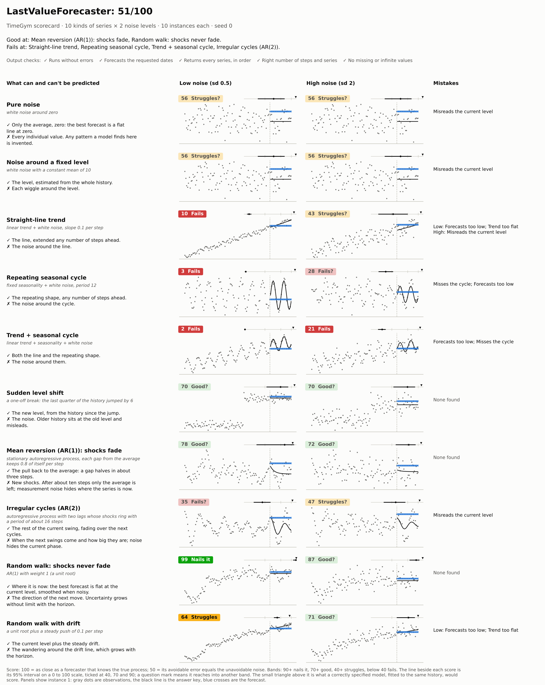
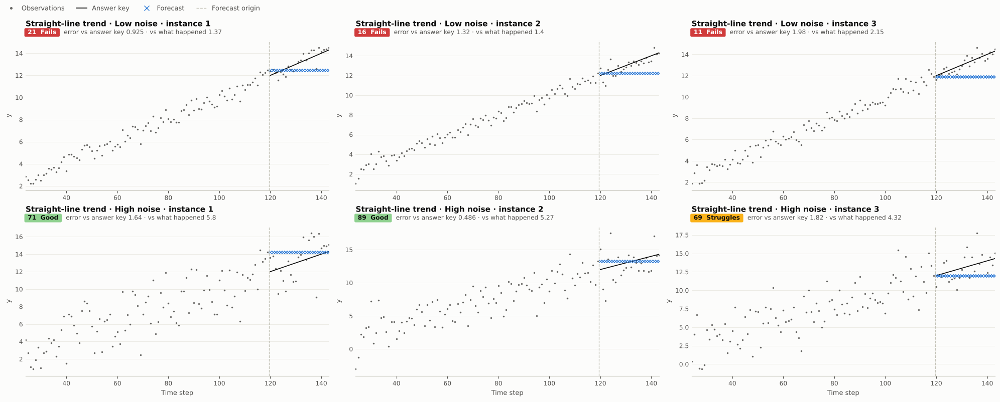
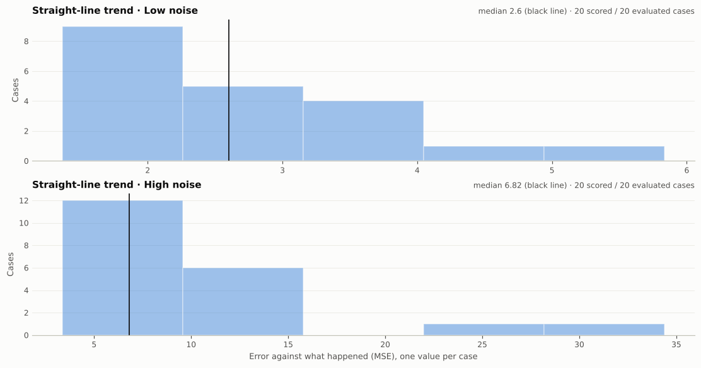
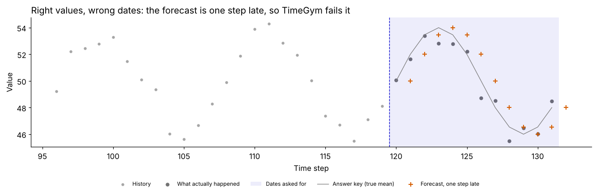

# TimeGym

**A gym for time series forecasting algorithms.**

[](https://diogoseca.github.io/timegym/)
[](https://github.com/diogoseca/timegym/actions/workflows/checks.yml)
[](https://pypi.org/project/timegym/)
[](LICENSE)

**[Documentation](https://diogoseca.github.io/timegym/)** ·
[Quick start](https://diogoseca.github.io/timegym/tutorials/01_quick_start/) ·
[Examples](https://diogoseca.github.io/timegym/docs/examples/) ·
[Tutorials](https://diogoseca.github.io/timegym/docs/tutorials/) ·
[API](https://diogoseca.github.io/timegym/docs/reference/) ·
[Changelog](CHANGELOG.md)

```python
from timegym import LastValueForecaster, Pipeline

pipeline = Pipeline(LastValueForecaster())   # put your own forecaster here
result = pipeline.run()
result.scorecard
```

[](https://raw.githubusercontent.com/diogoseca/timegym/main/docs/images/scorecard.png)

[OpenAI Gym](https://arxiv.org/abs/1606.01540) gave reinforcement-learning
agents a standard set of environments to train and be tested in. TimeGym does
the same for forecasters. It generates time series whose future it already
knows the odds of: noise, trends, seasons, sudden shifts, cycles, levels pulled
back to their mean, random walks, each at low and at high noise. It hands your
forecaster the past, asks for the future, and scores the answer against the
truth. One scorecard shows what your algorithm nails, where it struggles and
where it fails.

## Install

```bash
pip install timegym
```

<!-- BEGIN PYTHON SUPPORT -->
Python 3.11–3.15 (`>=3.11,<3.16`), following pandas support.
<!-- END PYTHON SUPPORT -->

## The example, step by step

### 1. Wrap your forecaster in a `Pipeline`

```python
from timegym import LastValueForecaster, Pipeline

pipeline = Pipeline(LastValueForecaster())
```

The pipeline holds your forecaster and runs it on TimeGym's series: it hands
over the history of each one, asks for the next steps, checks the answer and
scores it.

### 2. Pick the forecaster

`LastValueForecaster` is built in. It repeats the last value it saw at every
future step: the simplest forecast there is, and the one any real model should
beat.

Other built-in forecasters go in the same place:

```python
from timegym import (DriftForecaster, GaussianAR1Forecaster, MeanForecaster,
                     SeasonalLastValueForecaster)

MeanForecaster()                         # the average of the history
DriftForecaster()                        # the trend from first to last value
SeasonalLastValueForecaster(period=12)   # repeat the last 12 values
GaussianAR1Forecaster()                  # mean reversion, with a range
```

A scikit-learn regressor plugs in directly; the pipeline feeds it the last
`window_length` values:

```python
from sklearn.linear_model import Ridge

ridge = Pipeline(Ridge(), window_length=12)
```

Your own forecaster is any object with two methods. `fit(history)` gets the
series so far. `predict(future_index)` gets the dates to forecast, the steps
right after the history, and returns one value per date: a `Forecast`, or
simply a list or NumPy array. This one repeats the last value it saw:

```python
from timegym import Forecast

class RepeatLast:
    def fit(self, history):            # the series so far, one column per series
        self.last = history.iloc[-1]   # the last row seen
        return self

    def predict(self, future_index):   # the dates to forecast
        return Forecast(future_index, [self.last] * len(future_index))

mine = Pipeline(RepeatLast())
```

It makes the same forecasts as `LastValueForecaster`, so it gets the same
scorecard. [Write and test a custom model](https://diogoseca.github.io/timegym/tutorials/02_custom_model/)
adds several series, quantiles and a nearest-analogues forecaster.

### 3. Run it and look at the scorecard

```python
result = pipeline.run()
card = result.scorecard
card
```

In a notebook, `card` on its own shows the picture at the top of this page.
`run()` draws ten series of each kind at each noise level, forecasts each one
and scores the forecasts. Outside a notebook, save the picture with
`card.save("scorecard.png")`; [What you can do with a scorecard](#what-you-can-do-with-a-scorecard)
lists the rest.

## Reading the scorecard

### Rows and columns

Each row is a kind of series and each column a noise level. The left column
says what can and cannot be predicted for that kind of series. The right
column names the mistakes the model made there.

### The score

Each cell gets a score from 0 to 100. It compares two errors: the noise nobody
could avoid, and your model's avoidable error, which is how far its forecast is
from the answer key (the expected value of each future step, which TimeGym
knows because it made the series):

```text
score = 100 × unavoidable error / (unavoidable error + avoidable error)
```

- **100** is the top. The forecast matched the answer key exactly, as a
  forecaster that knows how the series was made would. No forecast can do
  better.
- **50** means the avoidable error is as large as the noise nobody could avoid.
- **Near 0** means the avoidable error dwarfs the noise: the forecast is far
  from the answer key.

The score falls into one of four bands:

| Score | Band |
| --- | --- |
| 90 and up | Nails it |
| 70 to 89 | Good |
| 40 to 69 | Struggles |
| Below 40 | Fails |

The score at the top of the card is the average of the cell scores.

### What the last-value forecaster scored

The last-value forecaster scores 51. It nails the random walk at low noise
(99): when every step adds a shock that never fades, the last value is the
best forecast anyone can make. It fails trends and seasons (10 and 3 at low
noise), because repeating the last value cannot follow a line or a cycle.

### How sure each score is

The short line beside each score is its 95% interval: with other series of the
same kind the score would come out a little different, and the line shows by
how much. A question mark after the band means the line reaches into another
band, so ten series were not enough to settle it.

Draw more series per cell for a shorter line, or ask for a more cautious one:

```python
pipeline.run(instances=30).scorecard          # 30 series per cell, not 10
pipeline.run(interval_level=0.99).scorecard   # a 99% interval: a longer line
```

### The triangle

The small triangle above the line is what the right kind of model for that row
scores when it is fitted to the same history: a straight line for the trend, a
repeating cycle for the seasons, and so on. Even that model loses a few points
to estimating its settings from a short history, so the triangle sits a little
below 100. The distance from your score up to the triangle is what your model
loses on top of that.

## What `run()` gives you

`pipeline.run()` is the one call. Its result holds:

| You read | You get | Use it to |
| --- | --- | --- |
| `result.scorecard` | A `Scorecard`: the picture and its table | See what the model is good and bad at |
| `result.report` | A `TestReport`: every case's metrics and output checks | Save them as JSON, compare two models |
| `result.assert_passed()` | An error when a forecast is malformed or the model crashed | Fail a CI build |
| `result.plot_errors()` | How the errors spread, row by row | See whether a score comes from a few bad cases |
| `result.plot_forecasts()` | Every series, with the answer key and the forecast | See the forecasts behind a score |

The series and forecasts are dropped once they are scored. Pass
`keep_data=True` to keep them, as `plot_forecasts()` needs.

With nothing in the brackets, `run()` draws the scorecard's series. To test
series you choose, pass them first: keys such as `["trend"]`, a `Pattern` of
your own, or `Scenario` objects. Your own data goes in `cases=`; it has no
answer key, so that result has no scorecard.

## What you can do with a scorecard

- Show it in a notebook: `card` on its own.
- Save it as a PNG, SVG or PDF image, for a report or a slide.
- Print it as Markdown, for a pull request or a log.
- Take its numbers as a table, and save them as CSV or JSON.
- Save every case's metrics and output checks as JSON.
- Plot the forecasts behind a score.
- Fail a CI build when a forecast is malformed or the model gets worse.

### Save it as an image

The file extension picks the format:

```python
card.save("scorecard.png")
card.save("scorecard.svg")
card.save("scores.png", compact=True)   # only the colored scores
```

`card.plot()` returns the matplotlib figure, to restyle it or place it in a
figure of your own.

### Print it as Markdown

```python
print(card)
```

```text
## LastValueForecaster: 51/100

| Pattern | Low noise | High noise | Mistakes |
|---|---|---|---|
| Pure noise | 56 Struggles? | 56 Struggles? | Misreads the current level |
| Straight-line trend | 10 Fails | 43 Struggles? | Low: Forecasts too low; Trend too flat · High: Misreads the current level |
| Random walk: shocks never fade | 99 Nails it | 87 Good? | none found |
…

14 of 20 verdicts are not settled at 10 instances. Run pipeline.run(instances=30) to narrow them.
```

### Take the numbers as a table

`card.table` is a pandas DataFrame with one row per kind of series and noise
level: the score, the two ends of its interval, the band, the triangle's score,
the mistakes and the errors behind the score.

```python
card.table.to_csv("scorecard.csv", index=False)
card.table.to_json("scorecard.json", orient="records", indent=1)
```

`result.save` saves the report: every case's metrics and output checks,
enough to replay one case on another machine:

```python
result.save("report.json")
```

### Look closer at one row

Score one row on its own, at both noise levels, and keep its series to plot
them:

```python
trend = pipeline.run(["trend"], instances=3, keep_data=True)
```

Plot every draw behind that row, with the answer key and the forecast:

```python
trend.plot_forecasts()
```

[](https://raw.githubusercontent.com/diogoseca/timegym/main/docs/images/readme-trend-forecasts.png)

See how the error spreads over 20 draws per noise level:

```python
pipeline.run(["trend"], instances=20).plot_errors(metric="mse")
```

[](https://raw.githubusercontent.com/diogoseca/timegym/main/docs/images/readme-trend-errors.png)

`mse` is the error against what actually happened. The default,
`avoidable_mse`, is the error against the answer key: the part your model
could have avoided.

### Use it in CI

Fail a CI build when a forecast is malformed or the model crashes:

```python
result.assert_passed()
```

To catch a change that makes the model worse, save the scorecard of the version
you trust and compare each later version with it on the same series. A paired
test says, cell by cell, whether the new version is further from the answer key:

```python
# once, on the version you trust
pipeline.run(instances=30).scorecard.save_baseline("baseline.json")

# on every later version
diff = pipeline.run(instances=30).scorecard.compare("baseline.json")
diff.assert_no_regression()   # fail a CI build on a cell that got worse
```

### Beyond the scorecard

On your own data, which has no answer key, `new.compare(old, metric="mae")`
pairs two reports case by case and says whether `new` is better, worse, or
shows no clear difference, by group if you ask
([Metrics and diagnostics](https://diogoseca.github.io/timegym/docs/api/diagnostics/#compare-two-forecasters-on-the-same-cases)).
Checks of your own join the built-in ones with `checks=`, such as
`within(0, None)` for rainfall or sales, which can't go below zero
([Your own output checks](https://diogoseca.github.io/timegym/docs/api/diagnostics/#your-own-output-checks)).
For yes/no outcomes, `result.calibration()`, on a result made with
`keep_data=True`, says whether a forecast of 70% came true about 70% of the time
([Are the chances honest?](https://diogoseca.github.io/timegym/docs/api/diagnostics/#are-the-chances-honest)).
A kind of series you can simulate, with its answer key, becomes a scorecard
row of your own: pass a `Pattern` to `run()` beside the built-in keys
([Your own kind of series](https://diogoseca.github.io/timegym/docs/api/scorecard/#your-own-kind-of-series)).

The [Quick start](https://diogoseca.github.io/timegym/tutorials/01_quick_start/) shows the rest:
how many draws to use, what `seed=None` does, and `pipeline.run` on series you
choose. [Scorecards and the scenario grid](https://diogoseca.github.io/timegym/docs/api/scorecard/)
lists every attribute.

## Why not just backtest?

A backtest compares your forecast with the one future that happened. That
future is noisy, so a lucky model looks good and a sound one can look bad.
TimeGym made the data, so it holds the answer key: the expected value and the
spread of every future step. It scores your forecast against that key, which
measures skill rather than luck.

**A score can also hide a bug.** Put the right numbers on the wrong dates and
any scorer that compares arrays gives them exactly the same error. TimeGym
checks the dates, the series and the shape first, and fails the forecast with
the reason before it scores anything.

[](https://diogoseca.github.io/timegym/tutorials/03_faults_repairs_and_replay/)

## What TimeGym checks

Every forecast goes through three questions, in this order.

**1. Is the forecast well-formed?** These output checks run on every forecast
(in the code, the *forecast contract*):

- Forecasts the requested dates; a failure says how many steps they are off
- Returns every series, in order
- Right number of steps and series
- No missing or infinite values
- Quantiles in order, when the forecast has quantiles
- Runs without errors

A forecast that fails a check fails the test with the reason and is never
scored, so a bug cannot pass as a slightly worse error.

**2. How far is it from the answer key?** Because TimeGym generated the series, it knows the expected value and the spread of every future step (in the code, the *reference*), so your forecast is scored against both the key and what actually happened.

**3. Does it do what you declared?** Optional checks for specific properties: a model that claims to shift its forecast when the data shift can be tested for it, and sample paths can be tested for the right correlation between series.

Each check returns one of five verdicts (`PASS`, `FAIL`, `INCONCLUSIVE`, `UNSUPPORTED`, `ERROR`) and the numbers that led to it. Metrics are always `INCONCLUSIVE`: TimeGym tells you how far off you are and leaves the pass mark to you. [How TimeGym decides](https://diogoseca.github.io/timegym/docs/concepts/how-timegym-decides/) explains each verdict, and [Metrics and diagnostics](https://diogoseca.github.io/timegym/docs/api/diagnostics/) each metric.

## Scenarios

The scorecard's rows are ten kinds of series, from pure noise to random walks with drift, each drawn at low noise (standard deviation 0.5) and high noise (2.0). For each one TimeGym knows what a forecast *can* get right and what nobody can predict; the scorecard prints both, and [Scorecards and the scenario grid](docs/api/scorecard.md#the-grid) lists all ten. The [scenario guide](docs/stress-cases.md) explains each kind in plain terms, why mean reversion and the random walk are the same equation, and the composed and financial ones beyond the scorecard: price jumps, volatility clusters (GARCH) and hidden regime switches, alone or across several correlated series.

## Examples

Forecasting jobs on real public data, from the first model to a decision, with
TimeGym in the loop. The [examples page](https://diogoseca.github.io/timegym/docs/examples/)
shows them with their results and says how to run them.

| Example | What TimeGym showed |
|---|---|
| [Weekly shop sales: from forecast to stock order](https://diogoseca.github.io/timegym/examples/store-sales/) | Why the usual regression loses to a plain average on a gift shop's products, and which simpler forecaster leaves fewer units out of stock |
| [Spare parts: the best score goes to a forecast of zero](https://diogoseca.github.io/timegym/examples/spare-parts/) | The lowest average error belongs to a forecast of zero; a score in the parts counter's terms names the forecaster that keeps parts on the shelf |
| [The Christmas order: five Decembers cannot pick the forecaster](https://diogoseca.github.io/timegym/examples/christmas-order/) | A shop with five Decembers to test on: one argument fixes a forecast that came in at half, two forecasters tie, and generated shops with a known answer show what each choice costs |
| [Call center staffing: forecast again at ten o'clock](https://diogoseca.github.io/timegym/examples/call-center/) | What a newer forecast is worth to a staffing plan: yesterday's surprise 15%, the calls taken by 10:00 another 12%, and trusting the morning in full makes it worse |
| [Train station riders: what is the weather worth, at best?](https://diogoseca.github.io/timegym/examples/station-riders/) | Is a weather feed worth building? Told the real weather, a ridership forecast gains under 2% on weekdays and 8% on weekends, and nothing at some stations |
| [Daily births: how much history should a forecast learn from?](https://diogoseca.github.io/timegym/examples/daily-births/) | Each part of a forecast has its own best look-back: all the history makes the week 28% worse, one year makes the season 12% worse, and a generated series with a known change shows why |
| [Tomorrow's electricity demand: let the worst days say what is missing](https://diogoseca.github.io/timegym/examples/electricity-demand/) | Which days a day-ahead forecast gets wrong, round by round: the weekday, then public holidays, then weather the data lacks |
| [Solar farm output: a range for every half hour is not a range for the day](https://diogoseca.github.io/timegym/examples/solar-farm/) | Two forecasts with the same range for every half hour: one range for the day's energy holds on 84% of days, the other on 33%, and only a score for the whole day sees the difference |
| [River flow: checking the range, not only the forecast](https://diogoseca.github.io/timegym/examples/river-flow/) | A 90% range that holds on average but not month by month, the one argument that repairs it, and how far it fails when the river rises |
| [Will it rain tomorrow? Score the forecast you already have](https://diogoseca.github.io/timegym/examples/rain/) | A yes/no forecast scored as a probability: our best forecaster gains 11% on the long-run share, the weather service's published forecast 53% |
| [Tomorrow's temperature: which city should Sydney watch?](https://diogoseca.github.io/timegym/examples/daily-temperature/) | Forecasting several series together: Melbourne's record cuts the miss on Sydney's high by 14%, and Darwin's makes it worse |
| [Tomorrow's air in London: the gaps someone filled in for you](https://diogoseca.github.io/timegym/examples/air-quality/) | Scores earned against filled-in readings: a table with no gaps makes every forecast look a fifth better than it is, and the silent monitors look easiest |
| [Flu season: the calendar knows the rhythm, not the peak](https://diogoseca.github.io/timegym/examples/flu-season/) | A forecaster that learns the season from earlier winters: ahead when the peak keeps its week, the worst of four when it comes late, and far below every peak four weeks before |
| [The sunspot cycle: how far ahead is a forecast worth making?](https://diogoseca.github.io/timegym/examples/sunspots/) | A regression that leads for two years ahead and adds nothing after |
| [El Niño: how far ahead depends on the month you ask](https://diogoseca.github.io/timegym/examples/el-nino/) | A backtest's "seven months ahead" split by the month each forecast was made: nothing gets across April, and the rest is still ahead at nine months |
| [The forest that cannot follow growth](https://diogoseca.github.io/timegym/examples/passenger-growth/) | A random forest that passes its backtest cannot forecast a trend, and the textbook fix makes it worse elsewhere |
| [You tried 50 models: is the winner real?](https://diogoseca.github.io/timegym/examples/best-of-fifty/) | The winner of a 50-setting backtest leads by 0.2%; nine others cannot be told apart from it, and the next year it comes tenth |
| [Ready-made model or your own? Five products decide](https://diogoseca.github.io/timegym/examples/ready-made-model/) | A pretrained model far ahead on the scorecard and 22% behind on the backtest average: five products carry the gap, and generated series with a known answer show when the error happens |
| [A traffic jump: is this the new normal?](https://diogoseca.github.io/timegym/examples/traffic-jump/) | The forecaster that is as good as any on ordinary days is the worst three days into a jump, and the usual backtest cannot show it |
| [Site capacity: which forecast still works four weeks ahead?](https://diogoseca.github.io/timegym/examples/site-capacity/) | Two forecasters that are level for next week are far apart four weeks ahead, where capacity is booked, and a one-day slip shows up on a generated weekly cycle before any real data |
| [Bitcoin: finding out you have nothing](https://diogoseca.github.io/timegym/examples/bitcoin/) | A 79% hit rate that came from one input reaching into the future |
| [The S&P 500 next week: the direction and the size are different questions](https://diogoseca.github.io/timegym/examples/sp500/) | The direction cannot be forecast and the size can: a range that follows recent weeks holds in crashes, checked year by year |

## Tutorials

| Group | Notebook | What it shows |
|---|---|---|
| Start | [Quick start](https://diogoseca.github.io/timegym/tutorials/01_quick_start/) | Two scorecards, last value against Ridge: each is blind where the other sees |
| | [Write and test a custom model](https://diogoseca.github.io/timegym/tutorials/02_custom_model/) | The six-line RepeatLast model, nearest analogues, real data |
| Find what breaks | [Faults, repairs and replay](https://diogoseca.github.io/timegym/tutorials/03_faults_repairs_and_replay/) | Four ways to break a correct forecast, a bug caught by a broken promise, replay |
| Shape the forecast | [Target transforms](https://diogoseca.github.io/timegym/tutorials/04_target_transforms/) | Why logs help when the swing grows with the level, and why exp(mean log) is too low |
| | [Reductions](https://diogoseca.github.io/timegym/tutorials/05_reductions/) | Recursive, direct and multioutput: when recursive errors compound |
| | [Multivariate forecasting](https://diogoseca.github.io/timegym/tutorials/06_multivariate_forecasting/) | Right numbers under the wrong series name; when extra history doesn't help |
| | [Real-data forecasts](https://diogoseca.github.io/timegym/tutorials/07_real_data_forecasts/) | No answer key: four origins, three baselines, a leakage check |
| Measure uncertainty | [Univariate uncertainty](https://diogoseca.github.io/timegym/tutorials/08_univariate_uncertainty/) | Same predictions, overconfident spread: which scores notice |
| | [Multivariate uncertainty](https://diogoseca.github.io/timegym/tutorials/09_multivariate_uncertainty/) | Scrambled pairings: every series right, joint risk gone |
| Stress-test | [Capability sweeps](https://diogoseca.github.io/timegym/tutorials/10_capability_sweeps/) | Three simple bets, and where each breaks as history and noise change |
| | [Composed and financial stresses](https://diogoseca.github.io/timegym/tutorials/11_composed_and_financial_stresses/) | A ladder of mechanisms, bad luck vs a bad model, a conversion bug |
| | [Joint financial uncertainty](https://diogoseca.github.io/timegym/tutorials/12_joint_financial_uncertainty/) | Assets that crash together, and the check that notices a lost link |

The tutorials run on CPU with local data; [Run the notebooks](https://diogoseca.github.io/timegym/docs/tutorials/#run-the-notebooks)
gives the two commands, and the [tutorials guide](tutorials/README.md) describes the folder.

## Scope and development

TimeGym tests forecasters; it does not fix them. It does not find the root
cause of a bug, repair a model, detect data leakage in general, or work out an
answer key for data you bring yourself: real data is scored against what
happened, and the checks that need a key say `UNSUPPORTED`. To score your own
data, cut a series into cases with `cases_from_series` and pass them to
`pipeline.run(cases=...)`; forecasts made elsewhere are scored with
`ForecastRun.from_forecasts`. Panels, hierarchies and missing observations are
out of scope for now; [Data preparation](docs/api/data-preparation.md#irregular-readings)
shows how to put readings taken at irregular times on a regular grid without
letting the future in.
[What TimeGym tests, and what it does not](docs/concepts/scope.md) draws the line in more detail,
and [Extend TimeGym](docs/concepts/extend.md) lists every place to plug in your own code and data.

The package is written in notebooks: the [source notebooks](source/README.md)
in `source/` generate every module in `timegym/`. [Contributing](docs/contributing.md)
describes that cycle, and [releasing](docs/release.md) the version numbers and
how a merged pull request becomes a PyPI release.

## Cite

Cite the software by version; GitHub's "Cite this repository" reads the same
metadata from [CITATION.cff](CITATION.cff). When a release is archived on
Zenodo, cite that release's DOI.

<!-- BEGIN GENERATED CITATION -->

```bibtex
@software{seca2026timegym,
  author = {Seca, Diogo},
  title = {{TimeGym: verification and diagnosis for forecasting pipelines}},
  year = {2026},
  version = {1.14.1},
  url = {https://github.com/diogoseca/timegym},
}
```

Seca, D. (2026). *TimeGym: verification and diagnosis for forecasting pipelines*
(Version 1.14.1) [Computer software]. https://github.com/diogoseca/timegym

The 2021 preprint (arXiv version 1, the original prototype):

```bibtex
@article{seca2021timegym,
  author = {Seca, Diogo},
  title = {{TimeGym: Debugging for Time Series Modeling in Python}},
  year = {2021},
  doi = {10.48550/arXiv.2105.01404},
  url = {https://arxiv.org/abs/2105.01404v1},
}
```

<!-- END GENERATED CITATION -->

MIT license. Datasets and cited works keep their own attribution; see
[data provenance](experiments/data/README.md).
