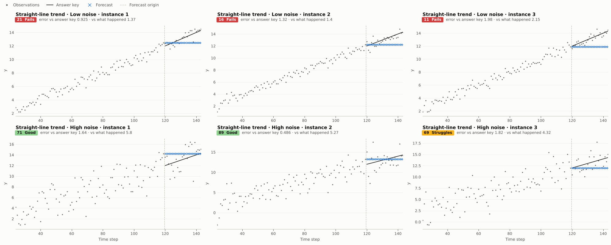
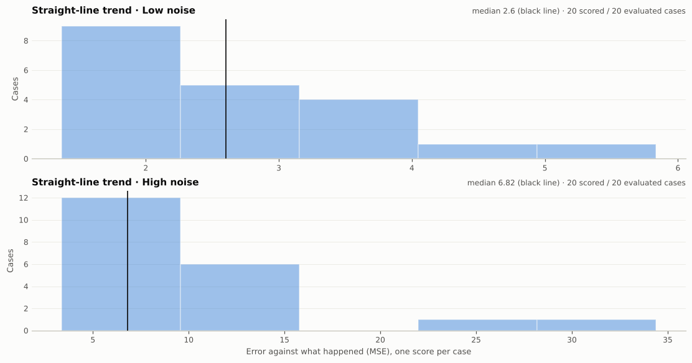
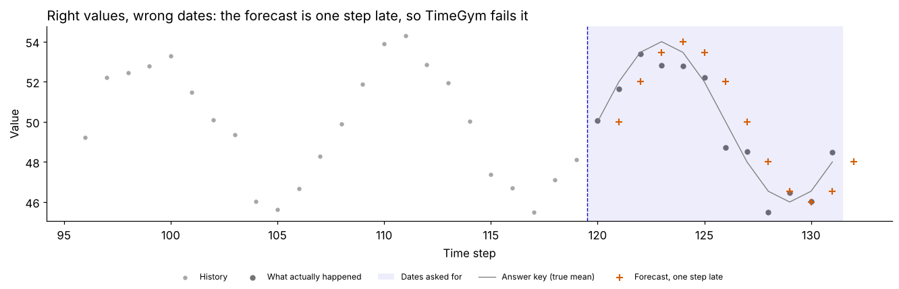

# TimeGym

**A gym for time series forecasting algorithms.**

[](https://diogoseca.github.io/timegym/)
[](https://github.com/diogoseca/timegym/actions/workflows/checks.yml)
[](https://pypi.org/project/timegym/)
[](LICENSE)

[OpenAI Gym](https://arxiv.org/abs/1606.01540) gave reinforcement-learning
agents a standard set of environments to train and be tested in. TimeGym does
the same for forecasters. It generates time series whose future it already
knows the odds of: noise, trends, seasons, sudden shifts, cycles, levels pulled
back to their mean, random walks, each at low and at high noise. It hands your
forecaster the past, asks for the future, and scores the answer against the
truth. One picture shows what your algorithm nails, where it struggles and
where it fails.

**[Documentation](https://diogoseca.github.io/timegym/)** ·
[Quick start](https://diogoseca.github.io/timegym/tutorials/01_quick_start/) ·
[Tutorials](https://diogoseca.github.io/timegym/docs/tutorials/) ·
[API](https://diogoseca.github.io/timegym/docs/reference/) ·
[Changelog](CHANGELOG.md)

## Sixty seconds

```bash
pip install timegym
```

<!-- BEGIN PYTHON SUPPORT -->
Python 3.11–3.15 (`>=3.11,<3.16`), following pandas support.
<!-- END PYTHON SUPPORT -->

Wrap your forecaster in a `Pipeline` and ask for its scorecard. The built-in
`LastValueForecaster`, which repeats the last value it saw, stands in for yours
here:

```python
from timegym import LastValueForecaster, Pipeline

pipeline = Pipeline(LastValueForecaster())   # put your own forecaster here
card = pipeline.scorecard()
card.save("scorecard.png")
```

[](https://raw.githubusercontent.com/diogoseca/timegym/main/docs/images/scorecard.png)

Each row is a kind of series and each column a noise level. The left column
says what can and cannot be predicted for that kind of series, and the right
column names the mistakes the model made there. A score of 100 means the
forecasts were as close as those of a forecaster that knows exactly how the
series was made; 50 means the model's avoidable error is as large as the noise
nobody could avoid. The bands read "Nails it" from 90, "Good" from 70,
"Struggles" from 40 and "Fails" below that. The last-value forecaster scores
51: it nails the random walk and fails trends and seasons. The short line beside
each score is its 95% interval on a 0 to 100 scale, and a question mark means
that interval reaches into another band; `pipeline.scorecard(instances=30)`
narrows it. In a notebook, `card` on its own shows the picture.

### Scorecard, test and report

A scorecard is a test on TimeGym's ten kinds of series, drawn as one picture.
"Test" is what TimeGym does; the report is the record it hands back. Three
calls give you three views of the same work:

| You call | You get | Use it to |
| --- | --- | --- |
| `pipeline.scorecard()` | A `Scorecard`: the picture and its table | See what the model is good and bad at |
| `pipeline.test(scenarios)` | A `TestReport`: every case's scores and output checks | Test series you choose, save them as JSON, fail a CI build |
| `pipeline.run(scenarios)` | A `ForecastRun`: the report plus every series and forecast | Plot the forecasts behind the scores |

A scorecard carries the other two: `card.report` and `card.run`.

### More things to do with a scorecard

Print it as Markdown, for a pull request or a log:

```python
print(card)
```

```text
## LastValueForecaster: 51/100

| Pattern | Low noise | High noise | Mistakes |
|---|---|---|---|
| Pure noise | 56 Struggles? | 56 Struggles? | Misreads the current level |
| Straight-line trend | 10 Fails | 43 Struggles? | Low: Forecasts too low; Trend too flat · High: Misreads the current level |
| Random walk: shocks never fade | 99 Nails it | 87 Good? | none found |
…

14 of 20 verdicts are not settled at 10 instances. Run scorecard(instances=30) to narrow them.
```

Zoom in on one row:

```python
trend = pipeline.scorecard(["trend"], instances=3)   # one row, both noise levels
```

Plot every draw behind that row, with the answer key and the forecast:

```python
trend.run.plot_forecasts()
```

[](https://raw.githubusercontent.com/diogoseca/timegym/main/docs/images/readme-trend-forecasts.png)

See how the error spreads over 20 draws per noise level:

```python
pipeline.scorecard(["trend"], instances=20).run.plot_errors(metric="mse")
```

[](https://raw.githubusercontent.com/diogoseca/timegym/main/docs/images/readme-trend-errors.png)

`mse` is the error against what actually happened. The default,
`mean_reference_mse`, is the error against the answer key: the part your model
could have avoided.

For CI and for later:

```python
card.report.assert_passed()          # fail a CI build on a malformed forecast or a crash
card.report.to_json("report.json")   # every case, enough to replay one on another machine
```

The [Quick start](https://diogoseca.github.io/timegym/tutorials/01_quick_start/) shows the rest: the
scorecard as a DataFrame (`card.table`), how many draws to use and what `seed=None` does, and
`pipeline.test` on series you choose. [Scorecards and the scenario grid](https://diogoseca.github.io/timegym/docs/api/scorecard/)
lists every attribute.

## Why not just backtest?

A backtest compares your forecast with the one future that happened. That
future is noisy, so a lucky model looks good and a sound one can look bad.
TimeGym made the data, so it holds the answer key: the expected value and the
spread of every future step. It scores your forecast against that key, which
measures skill rather than luck.

**A score can also hide a bug.** Put the right numbers on the wrong dates and
any scorer that compares arrays gives them exactly the same error. TimeGym
checks the dates, the series and the shape first, and fails the forecast with
the reason before it scores anything.

[](https://diogoseca.github.io/timegym/tutorials/03_faults_repairs_and_replay/)

## Bring your own model

A forecaster is any object with two methods. `fit(context)` gets the series so
far. `predict(future_index)` gets the dates to forecast, the steps right after
the context, and returns one value per date: a `Forecast`, or simply a list
or NumPy array. This one repeats the last value it saw:

```python
from timegym import Forecast, Pipeline

class RepeatLast:
    def fit(self, context):            # the series so far, one column per series
        self.last = context.iloc[-1]   # the last row seen
        return self

    def predict(self, future_index):   # the dates to forecast
        return Forecast(future_index, [self.last] * len(future_index))

card = Pipeline(RepeatLast()).scorecard()
```

It scores 51, like the built-in `LastValueForecaster`.
[Write and test a custom model](https://diogoseca.github.io/timegym/tutorials/02_custom_model/)
adds several series, quantiles and a nearest-analogues forecaster.

scikit-learn regressors plug in directly, fed the last `window_length` values:

```python
from sklearn.linear_model import Ridge

card = Pipeline(Ridge(), window_length=12).scorecard()
```

## What TimeGym checks

Every forecast goes through three questions, in this order.

**1. Is the forecast well-formed?** These output checks run on every forecast
(in the code, the *forecast contract*):

- Forecasts the requested dates; a failure says how many steps they are off
- Returns every series, in order
- Right number of steps and series
- No missing or infinite values
- Quantiles in order, when the forecast has quantiles
- Runs without errors

A forecast that fails a check fails the test with the reason and is never
scored, so a bug cannot pass as a slightly worse error.

**2. How far is it from the answer key?** Because TimeGym generated the series, it knows the expected value and the spread of every future step (in the code, the *reference*), so your forecast is scored against both the key and what actually happened.

**3. Does it do what you declared?** Optional checks for specific properties: a model that claims to shift its forecast when the data shift can be tested for it, and sample paths can be tested for the right correlation between series.

Each check returns one of five verdicts (`PASS`, `FAIL`, `INCONCLUSIVE`, `UNSUPPORTED`, `ERROR`) and the numbers that led to it. Scores are always `INCONCLUSIVE`: TimeGym tells you how far off you are and leaves the pass mark to you. [How TimeGym decides](https://diogoseca.github.io/timegym/docs/concepts/how-timegym-decides/) explains each verdict, and [Scores and diagnostics](https://diogoseca.github.io/timegym/docs/api/diagnostics/) each score.

## Scenarios

The scorecard's rows are ten kinds of series, from pure noise to random walks with drift, each drawn at low noise (standard deviation 0.5) and high noise (2.0). For each one TimeGym knows what a forecast *can* get right and what nobody can predict; the scorecard prints both, and [Scorecards and the scenario grid](docs/api/scorecard.md#the-grid) lists all ten. The [scenario guide](docs/stress-cases.md) explains each kind in plain terms, why mean reversion and the random walk are the same equation, and the composed and financial ones beyond the scorecard: price jumps, volatility clusters (GARCH) and hidden regime switches, alone or across several correlated series.

## Tutorials

| Group | Notebook | What it shows |
|---|---|---|
| Start | [Quick start](https://diogoseca.github.io/timegym/tutorials/01_quick_start/) | Two scorecards, last value against Ridge: each is blind where the other sees |
| | [Write and test a custom model](https://diogoseca.github.io/timegym/tutorials/02_custom_model/) | The six-line RepeatLast model, nearest analogues, real data |
| Find what breaks | [Faults, repairs and replay](https://diogoseca.github.io/timegym/tutorials/03_faults_repairs_and_replay/) | Four ways to break a correct forecast, a bug caught by a broken promise, replay |
| Shape the forecast | [Target transforms](https://diogoseca.github.io/timegym/tutorials/04_target_transforms/) | Why logs help when the swing grows with the level, and why exp(mean log) is too low |
| | [Reductions](https://diogoseca.github.io/timegym/tutorials/05_reductions/) | Recursive, direct and multioutput: when recursive errors compound |
| | [Multivariate forecasting](https://diogoseca.github.io/timegym/tutorials/06_multivariate_forecasting/) | Right numbers under the wrong series name; when extra history doesn't help |
| | [Real-data forecasts](https://diogoseca.github.io/timegym/tutorials/07_real_data_forecasts/) | No answer key: four origins, three baselines, a leakage check |
| Measure uncertainty | [Univariate uncertainty](https://diogoseca.github.io/timegym/tutorials/08_univariate_uncertainty/) | Same predictions, overconfident spread: which scores notice |
| | [Multivariate uncertainty](https://diogoseca.github.io/timegym/tutorials/09_multivariate_uncertainty/) | Scrambled pairings: every series right, joint risk gone |
| Stress-test | [Capability sweeps](https://diogoseca.github.io/timegym/tutorials/10_capability_sweeps/) | Three simple bets, and where each breaks as history and noise change |
| | [Composed and financial stresses](https://diogoseca.github.io/timegym/tutorials/11_composed_and_financial_stresses/) | A ladder of mechanisms, bad luck vs a bad model, a conversion bug |
| | [Joint financial uncertainty](https://diogoseca.github.io/timegym/tutorials/12_joint_financial_uncertainty/) | Assets that crash together, and the check that notices a lost link |

The tutorials run on CPU with local data; [Run the notebooks](https://diogoseca.github.io/timegym/docs/tutorials/#run-the-notebooks)
gives the two commands, and the [tutorials guide](tutorials/README.md) describes the folder.

## Scope and development

TimeGym tests forecasters; it does not fix them. It does not find the root
cause of a bug, repair a model, detect data leakage in general, or work out an
answer key for data you bring yourself: real data is scored against what
happened, and the checks that need a key say `UNSUPPORTED`. Panels, hierarchies,
and missing or irregular observations are out of scope for now.

The package is written in notebooks: the [source notebooks](source/README.md)
in `source/` generate every module in `timegym/`. [Contributing](docs/contributing.md)
describes that cycle, and [releasing](docs/release.md) the version numbers and
how a merged pull request becomes a PyPI release.

## Cite

Cite the software by version; GitHub's "Cite this repository" reads the same
metadata from [CITATION.cff](CITATION.cff). When a release is archived on
Zenodo, cite that release's DOI.

<!-- BEGIN GENERATED CITATION -->

```bibtex
@software{seca2026timegym,
  author = {Seca, Diogo},
  title = {{TimeGym: verification and diagnosis for forecasting pipelines}},
  year = {2026},
  version = {1.4.1},
  url = {https://github.com/diogoseca/timegym},
}
```

Seca, D. (2026). *TimeGym: verification and diagnosis for forecasting pipelines*
(Version 1.4.1) [Computer software]. https://github.com/diogoseca/timegym

The 2021 preprint (arXiv version 1, the original prototype):

```bibtex
@article{seca2021timegym,
  author = {Seca, Diogo},
  title = {{TimeGym: Debugging for Time Series Modeling in Python}},
  year = {2021},
  doi = {10.48550/arXiv.2105.01404},
  url = {https://arxiv.org/abs/2105.01404v1},
}
```

<!-- END GENERATED CITATION -->

MIT license. Datasets and cited works keep their own attribution; see
[data provenance](experiments/data/README.md).
