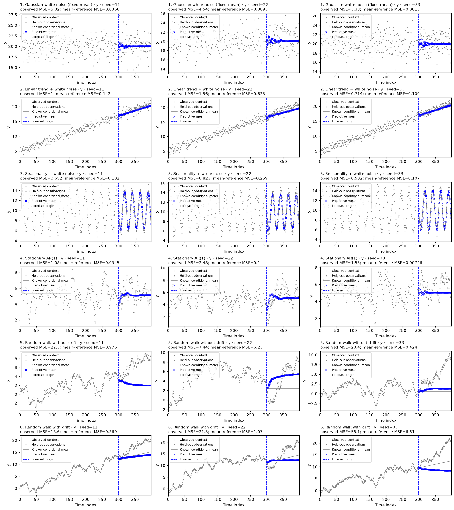

# TimeGym v2

**Controlled verification and diagnosis for forecasting pipelines.**

TimeGym tests forecast contracts, generates reproducible synthetic cases with
valid conditional references, and records why a check failed. It distinguishes
invalid outputs from model limitations and statistical uncertainty.

**A forecast can have the same numerical error and still be on the wrong dates.**
Try `timegym demo` to see that failure, its diagnostic report, and a verified
repair. Then use the notebooks to inspect point forecasts, marginal uncertainty,
and joint dependence with the same workflow.

This is the **0.2.0 development artifact** for a new v2 manuscript. The code and
paper are a focused, runnable pilot; no new package release or arXiv submission
has been published from this checkout.

## Install and run

Python 3.10 or later:

```bash
python -m venv .venv
source .venv/bin/activate
python -m pip install -e '.[dev]'
timegym demo --output /tmp/timegym-demo --plot
python examples/quickstart.py
python -m pytest
```

Install from this checkout; the v2 development version is not yet published to
PyPI. The demo writes two reports and a figure, and refuses to overwrite existing
artifacts. Choose another output directory when rerunning it.

Local tests pass on Python 3.13.2 with the scientific versions in
`requirements-study.txt`, and on Python 3.12 with NumPy 1.26.4, pandas 2.2.3,
SciPy 1.11.4, scikit-learn 1.4.2, and Matplotlib 3.8.4. CI is configured for
Python 3.10–3.13 and installed-wheel checks on Linux, macOS, and Windows;
those remote jobs have not been run from this checkout.
The [validation record](docs/validation.md) lists completed checks and remaining
release and research work.

```python
from timegym import Pipeline, Scenario, NaiveForecaster

pipeline = Pipeline(NaiveForecaster(strategy="last"))
report = pipeline.test(
    scenarios=[Scenario("random_walk", context_length=120, horizon=12)],
    seeds=[0, 1, 2],
)
report.to_json("report.json")
report.assert_passed()  # raises on FAIL or ERROR, not on unsupported capabilities
print(report.summary)
```

Reports from the built-in naive and Gaussian AR(1) models can be replayed safely:

```bash
timegym inspect report.json
timegym replay report.json --case-index 0
```

The report includes model parameters, scenario seeds, diagnostic settings,
dependency versions and a package-source fingerprint. Custom models and sklearn
pipelines are described in metadata but explicitly marked as requiring their
original integration code for replay; reports never dynamically import arbitrary
model names.

The [command-line guide](docs/cli.md) explains exit codes and environment checks.
Python users can load a report with `TestReport.read("report.json")`; loading
validates the schema, diagnostic statuses, finite values, and stored summary.

`assert_passed()` is a CI gate for detected failures. It does **not** mean every
capability was supported or that the model forecasts accurately. Accuracy scores
are descriptive `INCONCLUSIVE` evidence until a justified acceptance rule is
supplied. Optional covariance checks can reject clean ensembles at their stated
per-check significance level.

## What is implemented

- Explicit `ForecastTask`, `Forecast`, `Reference`, `Scenario`, and `TestReport` objects.
- Point means `(H,D)`, quantiles `(H,D,Q)`, and joint samples `(S,H,D)` with index,
  target order, shape, finite-value, and quantile-order checks.
- Fixed-mean white noise, linear trend plus white noise, seasonality,
  stationary AR(1), and random walks with or without drift; multiple
  targets with correlated Gaussian innovations; local seeded random generators.
- Composed trend/seasonality/noise, scheduled changes, Merton jumps, GARCH, and
  hidden regimes with optional jumps; joint shocks, jumps and regimes, with explicit reference capabilities.
- Conditional Gaussian means, variances, cross-horizon covariance, quantiles and
  samples. AR(1)/random-walk references condition on the last observed context.
- MSE, MAE, MASE, pinball loss, marginal empirical CRPS, energy and variogram scores.
- An optional finite Monte Carlo covariance check against a known reference law.
- Opt-in location-equivariance testing for models that explicitly claim it.
- Native naive/seasonal/drift and fitted Gaussian AR(1) baselines, plus a thin
  recursive scikit-learn adapter with training-only transforms and fresh fits.
- Eight output-fault fixtures and paired bypass repairs; model-level studies
  exercise lag order, recursive state, inverse scaling, and target order.

A reference is **privileged**: the evaluator knows the generating parameters;
ordinary models receive only history and requested future indexes. It supplies a
controlled diagnostic target, not information secretly given to a forecaster.
Mean-reference MSE is a squared distance to the conditional mean; MAE/MASE are
separate observed-data scores and need not rank mean forecasts the same way.

## Learn with Jupyter

Start with [00 · Quick start](notebooks/00_quick_start.ipynb): build a pipeline,
inspect a matrix of forecast cases, and compare error distributions. Forecast
means are blue crosses, observations are gray dots, and conditional references
are thin curves, continuing the visual language of the 2021 notebooks.

[](notebooks/00_quick_start.ipynb)

```bash
python -m pip install -e '.[notebooks]'
python -m jupyterlab notebooks
```

The [notebook guide](notebooks/README.md) brings everything into one folder:
**15 source notebooks build the package, and 9 application notebooks demonstrate
it**. Explore [univariate uncertainty](notebooks/20_univariate_uncertainty.ipynb),
[multivariate forecasts](notebooks/21_multivariate_forecasting.ipynb), or
[joint uncertainty](notebooks/22_multivariate_uncertainty.ipynb). The examples
use local data and CPU only. Explore the new [joint financial uncertainty notebook](notebooks/27_joint_financial_uncertainty.ipynb): correlated shocks, shared jumps and regimes, CCC-GARCH, preserved marginals with broken dependence, and repair verification. Explore the [composed and financial stress ladder](notebooks/26_composed_and_financial_stresses.ipynb) to add mechanisms one at a time; the [guide](docs/stress-cases.md) distinguishes generators from models under test.

Keep an evaluated run to inspect its actual forecasts without fitting again:

```python
run = pipeline.run(seeds=[0, 1, 2])
run.plot_forecasts()
run.plot_errors(metric="mean_reference_mse")
report = run.report
```

`run.cases` retains each case, forecast, and diagnostic result. Plotting an
existing run reuses those outputs. `pipeline.plot_tests(...)` and
`pipeline.plot_errors(...)` are convenient alternatives that each create a new run.

## Develop in notebooks

The source notebooks are authoritative for all 23 Python modules in `timegym/`.
Their implementation cells are collapsed but editable; demonstrations remain
beside the code they explain. This continues the original notebook-first
development workflow, using nbdev's modular exporter to regenerate complete
modules from saved cells:

```bash
python tools/export_notebooks.py
python tools/export_notebooks.py --check
python -m pytest
python notebooks/check_notebooks.py
```

Running notebook cells does not write package files. Save source edits and run
the explicit export command before testing the generated package. See
[contributing](docs/contributing.md) for the development cycle and
[source ownership](notebooks/source-map.json) for notebook-to-module mappings.

## Integrate an existing model

For scikit-learn (optional `timegym[sklearn]` dependency):

```python
from sklearn.preprocessing import StandardScaler
from sklearn.linear_model import Ridge
from timegym import Pipeline

pipeline = Pipeline(window_length=12)
pipeline.add(StandardScaler()).add(Ridge(alpha=1.0))
report = pipeline.test(seeds=[0])
```

For a native model, implement `fit(context: pandas.DataFrame)` and
`predict(future_index: pandas.Index) -> Forecast`. Supply an unfitted factory:

```python
pipeline = Pipeline(model_factory=lambda: MyForecaster(...))
```

Alternatively provide a zero-argument model class, or an instance implementing
`clone_unfitted()` that returns a fresh instance. TimeGym does not assume a deep
copy clears hidden fitted state. The supplied factory/clone must honor that
contract. Built-in step-based models require regular context indexes and the
immediately following consecutive future labels.

## Read and reproduce the paper

The original manuscript and its source are available from
[arXiv:2105.01404v1](https://arxiv.org/abs/2105.01404v1). The new version is
maintained inside this repository:

- [New manuscript](paper/main.tex), [generated single-file build](paper/timegym-v2.tex).
- [Manuscript build and figures](paper/README.md).
- [Verified references](paper/references.bib), [claim/evidence ledger](paper/claims.md).
- [Study protocols and evidence](experiments/README.md).
- [Recorded numerical results](experiments/results/results.json).
- [Publication strategy](docs/publication-strategy.md).
- [Migration notes](docs/migration.md).

Follow the [canonical reproduction recipe](paper/README.md) to reproduce both
studies and regenerate their tables, figures, and the standalone manuscript. The
[study guide](experiments/README.md) covers environment setup, separate-output
reruns, hash comparison, and rendering from frozen records.

The selected pilot detected the injected structural and distribution faults,
while retaining false alarms in clean controls. Its marginal-preserving
permutation leaves CRPS unchanged up to floating-point rounding and affects joint
scores. The inverse-scaling example improves four ordered origins of one real
series. These are deliberately bounded results, not a representative estimate of
all forecasting bugs or evidence of universal synthetic-to-real transfer.

The separately versioned supplement compares five checks on four implementation
defects across six conditions. It retains their misses and clean false alarms,
and reports the cost in detection power of correcting four simultaneous
covariance checks. One repair restores the intended recursion but worsens
average forecast loss on the tested random walks: algorithm correctness and
forecasting accuracy are distinct outcomes. See the
[supplement records](experiments/results-v2/results.json) and
[comparison figure](paper/figures/supplement-implementation-ablation.png).

## Scope

This release does not implement automatic root-cause localization, automatic
repair, general leakage detection, arbitrary DGP conditional inference, panels,
hierarchies, missing/irregular observations, foundation-model integrations, or
sktime/fev/GluonTS/Darts adapters. Quantile predictions are not treated as joint
sample paths. Unsupported outputs remain explicit rather than being fabricated.

The original ten development notebooks and Quick Start are preserved in
[the notebook archive](notebooks/archive/README.md), including their plots,
reasoning, implementation cells, and unfinished research directions. The
active notebooks modernize the supported topics; they do not imply that every
historical TODO has been implemented.

Code: MIT license. Dataset and scholarly sources retain their original
attribution; see [data provenance](experiments/data/README.md).

## Cite

Cite the software by version and source commit; GitHub's "Cite this repository"
button reads the same metadata from [CITATION.cff](CITATION.cff). When a release
is archived on Zenodo, cite that release's DOI instead.

```bibtex
@software{seca2026timegym,
  author  = {Seca, Diogo},
  title   = {{TimeGym}: verification and diagnosis for forecasting pipelines},
  year    = {2026},
  version = {0.2.0},
  url     = {https://github.com/diogoseca/timegym},
  note    = {Unreleased development version; record the source commit or report fingerprint you tested}
}
```

Seca, D. (2026). *TimeGym: verification and diagnosis for forecasting pipelines*
(Version 0.2.0) [Computer software]. https://github.com/diogoseca/timegym

The 2021 manuscript that this version corrects and extends:

```bibtex
@misc{seca2021timegym,
  author        = {Seca, Diogo},
  title         = {{TimeGym}: Debugging for Time Series Modeling in Python},
  year          = {2021},
  eprint        = {2105.01404},
  archivePrefix = {arXiv},
  primaryClass  = {cs.LG},
  doi           = {10.48550/arXiv.2105.01404},
  url           = {https://arxiv.org/abs/2105.01404v1}
}
```

See the [changelog](CHANGELOG.md) for the unreleased v2 changes. No v2 DOI or
publication record is claimed.
