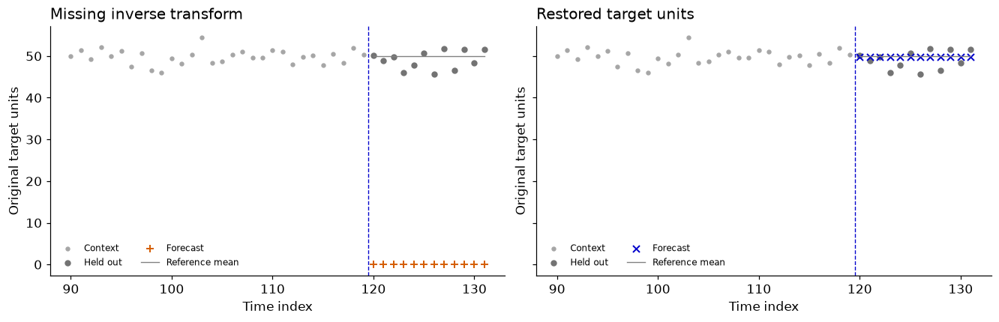

# Diagnose from the command line

After installing the checkout, no notebook environment is needed:

```bash
python -m pip install .
python -m timegym demo
```

The demo fits a drift baseline and shifts only its forecast index. Numerical
point errors are unchanged, but the forecast contract fails. Removing the known
fixture restores alignment. This demonstrates a specific diagnostic distinction;
it does not discover a repair or certify forecasting accuracy.

To keep a shareable comparison and two diagnostic reports:

```bash
python -m pip install '.[plots]'
timegym demo --seed 7 --output /tmp/timegym-demo --plot
```

Use a new output directory: the demo refuses to replace existing artifacts.
`faulty.json` records the injected fault; `repaired.json` records the unmodified
built-in forecast and supports normal replay. `summary.json` records the numerical
comparison and `alignment.png` shows the diagnostic beside the repaired forecast.



The invalid output is annotated instead of silently plotting it on the requested
dates. Gray dots are observations; blue crosses are forecast means. The thin
gray curve is the known conditional reference for this synthetic example.

## Inspect and replay saved evidence

```bash
timegym inspect /tmp/timegym-demo/faulty.json
timegym inspect /tmp/timegym-demo/repaired.json
timegym replay /tmp/timegym-demo/repaired.json --case-index 0
timegym replay /tmp/timegym-demo/repaired.json --require-same-environment
```

Inspection validates the report schema and summary before interpreting it.
Replay reconstructs only allowlisted built-in models. Custom models and output
mutations require their original code or fixture; report contents cannot request
an arbitrary Python import.

| Command | Exit 0 | Exit 1 | Exit 2 |
|---|---|---|---|
| `--version` | Print the installed package version | — | Invalid arguments |
| `demo` | Expected fault/repair contrast reproduced | Contrast failed | Invalid arguments, dependency or file error |
| `inspect` | No detected FAIL/ERROR | At least one failed case | Invalid report or file |
| `replay` | Required comparisons match | A comparison differs | Unsupported replay or invalid input |

An inspect exit of 0 can include UNSUPPORTED and INCONCLUSIVE checks. Decide
which capabilities your application requires from the full report. A successful
replay may reproduce a diagnostic failure; it certifies reproduction, not a pass.
The environment flag additionally requires source, dependency and Python matches.

Replay reports `reproduced` and `same_environment` separately. Traceback path
changes do not change diagnostic reproduction; `traceback_match` preserves that
comparison as additional evidence. `--require-same-environment` checks source,
dependency, and Python agreement through `same_environment`.
