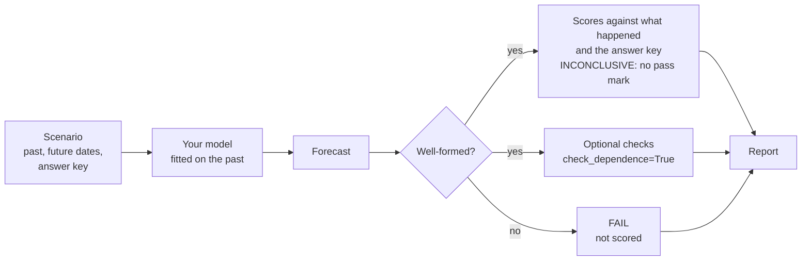

# How TimeGym decides

TimeGym asks three questions of every forecast, in order, and records a verdict
for each with the numbers behind it. This page explains the questions, the
verdicts and the words the rest of the documentation uses for them.

## In short

1. **Is the forecast well-formed?** Right dates, right series in the right
   order, one row per step, no NaN or infinity, quantiles that do not cross. If
   not, the case fails with a named reason and is not scored.
2. **How far is it from the answer key?** TimeGym generated the series, so it
   knows the expected value and the spread of every future step. The forecast
   is scored against that key and against what actually happened.
3. **Does it do what you declared?** Optional checks of properties a model
   claims, such as moving its forecast up when the data move up, or giving
   several series the right correlation.

TimeGym never turns a score into a pass mark. It reports how far off a forecast
is; you decide what is good enough. The scorecard's bands ("Nails it", "Good",
"Struggles", "Fails") are labels for reading the picture, not verdicts. A band
never fails `assert_passed`; only a failed output check or a crash does.

## Words these pages use

| Word | Plain meaning |
| --- | --- |
| Scenario | A recipe for a kind of series, such as noise around a trend |
| Case | One draw from a scenario: a past, a future and its answer key |
| Seed | The number that fixes a draw, so the same seed gives the same case |
| Context | The past the model sees: a pandas DataFrame, one row per time step, one column per series |
| Future index | The time labels the model must forecast |
| Horizon | How many steps ahead the model forecasts |
| Target | One of the series being forecast; a single series is named `y` |
| Forecast | The model's answer: point values, and optionally quantiles or sample paths |
| Reference | The answer key: the true expected value and spread of each future step, given the past |
| Forecast contract | The output checks of question 1 |
| Diagnostic | One check's result: a verdict, a message and its evidence |
| Evidence | The numbers a verdict rests on, saved with it |
| Report | Every case's scores and diagnostics, with the settings and versions that produced them |

## From case to verdict

Each case starts at a fixed point in time, the forecast origin, and the model is
fitted from scratch for every case, so nothing learned on one case leaks into
the next.

## What the five verdicts mean

| Verdict | Meaning |
| --- | --- |
| `PASS` | The check was run and satisfied. A pass covers that check only. |
| `FAIL` | Something is wrong: a malformed forecast or a broken declared property. |
| `INCONCLUSIVE` | Scored, but no pass mark is set. Every accuracy score returns it. |
| `UNSUPPORTED` | Not checked, because the forecast lacks what the check needs, for example quantiles for a quantile score. |
| `ERROR` | The model raised an exception. It is recorded with its traceback, never turned into a large error. |

A report with no `FAIL` and no `ERROR` means every forecast was well-formed and
every fit and prediction ran; with `check_dependence=True`, it also means no
set of sample paths had the wrong correlation. It does not mean the forecasts
are accurate. A large error can come from noise in a small test, from a model
too simple for the series, or from a bug, and a fixed pass mark cannot tell
which.

Pass marks on numerical results are a known source of flaky tests
([Nejadgholi and Yang 2019](https://doi.org/10.1109/ASE.2019.00078);
[Dutta et al. 2020](https://doi.org/10.1145/3395363.3397366)). Reporting scores
as `INCONCLUSIVE` keeps that choice with you. Where a check does use a
tolerance, the [diagnostics catalogue](../api/diagnostics.md#diagnostics-catalogue)
states it.

## Declared properties

Some properties hold only for some models, so TimeGym tests them only when you
say they apply. This is property-based testing: a property is written next to
the code and checked on generated inputs
([Claessen and Hughes 2000](https://doi.org/10.1145/351240.351266)), and the
scenarios supply those inputs. A property check runs on its own and returns one
`DiagnosticResult`; `Pipeline.test` does not add it to the report.

**Shift equivariance** (`timegym.checks.check_shift_equivariance`)

- *Property:* add a constant `c` to the past and the point forecast moves by
  `c`, that is `f(y + c) = f(y) + c`. The defaults are `shift=10.0`,
  `atol=1e-8` and `rtol=1e-7`.
- *When it holds:* for a model that declares it, such as a last-value or
  moving-average forecaster.
- *When it should not:* a model that clips forecasts at zero, uses absolute
  values as features, or shrinks towards a fixed level breaks it on purpose.
- *Verdicts:* `PASS` or `FAIL` with `max_absolute_error` as evidence; `ERROR`
  when either forecast is malformed; `UNSUPPORTED` without point forecasts.

[Tutorial 23](../../notebooks/23_faults_repairs_and_replay.ipynb) runs it on a
model that declares it.

## Testing the tests

A check earns trust by catching a known fault. The fault fixtures in
`timegym.mutations` break otherwise valid forecasts in known ways, such as
shifting the dates or swapping two series, and each repair should clear the
diagnostic its fault triggered. Injecting known faults to see whether a test
notices is an established way to evaluate tests
([Andrews et al. 2005](https://doi.org/10.1145/1062455.1062530);
[Just et al. 2014](https://doi.org/10.1145/2635868.2635929)). TimeGym's faults
are chosen by hand and change forecasts, not code, so they are called fault
fixtures rather than mutants. See [Fault fixtures](../api/fault-fixtures.md).

## Scores

[Scores and diagnostics](../api/diagnostics.md) lists every score and what it
rewards.

## What a report records

[Weyuker (1982)](https://doi.org/10.1093/comjnl/25.4.465) asked test
documentation to record five things. Each is a field of the saved `TestReport`:

| Weyuker's item | Where it is in a report |
| --- | --- |
| The criteria used | `metadata["pipeline_config"]`, `metadata["diagnostic_settings"]` and the diagnostic names |
| How far they were met | Each diagnostic's `status`, and `report.summary` |
| The test data | Each case's `scenario`, `seed` and `manifest` |
| The outputs | Each case's `metrics` and the diagnostic `evidence`. Forecasts are not stored; `replay_case` regenerates them |
| How correctness was decided | Each diagnostic's `category`, `message` and `evidence`, with version and dependency provenance in `metadata` |

[Pipeline and reports](../api/pipeline.md) documents the format and replay.

## Where these ideas come from

In software testing, the thing that decides whether an output is correct is
called an oracle. A forecaster has no exact correct output, so it is what
[Weyuker (1982)](https://doi.org/10.1093/comjnl/25.4.465) called a non-testable
program. Weyuker listed what remains possible: a partial oracle that checks only
some properties of the output, tests on simplified data with known results, and
known properties of the output.
[Davis and Weyuker (1981)](https://doi.org/10.1145/800175.809889) had proposed
the pseudo-oracle, an independent implementation of the same specification
whose outputs are compared within a tolerance, and
[Guderlei and Mayer (2007)](https://doi.org/10.1109/QSIC.2007.4385527) extended
property checks to programs with random output by comparing output
distributions with hypothesis tests.

None of these ideas is new. TimeGym makes each one runnable for forecasts and
records its assumptions in the report. In this vocabulary, the three questions
above are a partial oracle, simplified data with known results, and known
properties:

| Oracle type | TimeGym mechanism | Where to find it |
| --- | --- | --- |
| Partial oracle | The output checks: shape, dates, finiteness and quantile order | `forecast_contract` diagnostics; [Tasks and forecasts](../api/tasks-and-forecasts.md) |
| Simplified data with known results | Synthetic scenarios with an answer key | [Scenarios and references](../api/scenarios.md); [Synthetic scenarios](../stress-cases.md) |
| Known properties | Declared properties such as shift equivariance | `check_shift_equivariance`; [Scores and diagnostics](../api/diagnostics.md) |
| Pseudo-oracle | Independent NumPy lag-Ridge comparator | Study only, in `experiments/model_faults.py`; not part of the package |
| Statistical metamorphic test | Correlation check of sample paths against the answer key; calibrated loss alarm | `reference_covariance` diagnostic; the loss alarm is study only |

The [diagnostics catalogue](../api/diagnostics.md#diagnostics-catalogue) gives
the oracle type of every diagnostic the package emits, and the
[capability map](capability-map.md) shows which tutorial exercises each pair of
model behavior and oracle type. The
[TimeGym manuscript](../../paper/README.md) uses the same terms.

## Further reading

- [Barr et al. (2015)](https://doi.org/10.1109/TSE.2014.2372785) survey the
  oracle problem in software testing.
- [Seca (2021)](https://doi.org/10.48550/arXiv.2105.01407) reviews oracle issues
  in machine learning.
- [Chen et al. (2018)](https://doi.org/10.1145/3143561) review metamorphic
  testing.
