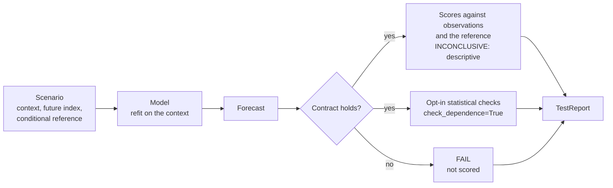

# How TimeGym decides

In TimeGym, verification means exercising specified runtime contracts, not
formal proof of a program. This page explains where each verdict in a report
comes from, using the terms of the [TimeGym manuscript](../../paper/README.md).

## Why forecasts need other oracles

A test needs an oracle: a way to decide whether an output is correct. A
forecaster has no exact expected output, so it is what
[Weyuker (1982)](https://doi.org/10.1093/comjnl/25.4.465) called a non-testable
program. Weyuker listed the remedies that remain: a partial oracle, tests on
simplified data with known results, and known properties of the output.
[Davis and Weyuker (1981)](https://doi.org/10.1145/800175.809889) had
already proposed the pseudo-oracle, an independent implementation of the same specification whose
outputs are compared within a tolerance.
[Guderlei and Mayer (2007)](https://doi.org/10.1109/QSIC.2007.4385527) extended
metamorphic relations to programs with random output by comparing output
distributions with hypothesis tests.

None of these ideas is new. TimeGym makes each one executable for forecasts and
records its assumptions in the report.

| Oracle type | TimeGym mechanism | Where to find it |
| --- | --- | --- |
| Partial oracle | Forecast contracts on shape, index, finiteness and quantile order | `forecast_contract` diagnostics; [Tasks and forecasts](../api/tasks-and-forecasts.md) |
| Simplified data with known results | Synthetic scenarios with conditional references | [Scenarios and references](../api/scenarios.md); [Synthetic scenarios](../stress-cases.md) |
| Known properties | Declared relations such as shift equivariance | `check_shift_equivariance`; [Scores and diagnostics](../api/diagnostics.md) |
| Pseudo-oracle | Independent NumPy lag-Ridge comparator | Study only, in `experiments/model_faults.py`; not part of the package |
| Statistical metamorphic test | Reference-covariance rank check; calibrated loss alarm | `reference_covariance` diagnostic; the loss alarm is study only |

The [diagnostics catalogue](../api/diagnostics.md#diagnostics-catalogue) gives
the oracle type of every diagnostic the package emits. The
[capability map](capability-map.md) crosses these oracle types with the
behaviors a forecaster needs, and shows which tutorial covers each pair.

## From case to verdict

Each case starts at a fixed forecast origin, and the model is refit from scratch
for every case. A forecast that breaks its contract is reported as `FAIL` and is
not scored.

## What the five outcomes mean

| Outcome | Meaning |
| --- | --- |
| `PASS` | An implemented check was satisfied. A pass is scoped to that check. |
| `FAIL` | An observed violation, such as a broken contract or a failed relation. |
| `INCONCLUSIVE` | The evidence does not support a verdict. Capability scores return it. |
| `UNSUPPORTED` | The check does not apply, for example a quantile score for a point-only model. |
| `ERROR` | Execution failed. A model exception is not silently converted into a numerical loss. |

A report with no `FAIL` and no `ERROR` means every forecast met its contract,
every fit and prediction ran without an exception, and, with
`check_dependence=True`, no sample covariance was rejected against its reference
law. It does not mean the forecasts are accurate. Capability scores are
descriptive because the package imposes no universal acceptance tolerance, and a
large score can reflect estimation noise, a limited model class or an
implementation fault.

Tolerance-based assertions are a common source of flaky tests
([Nejadgholi and Yang 2019](https://doi.org/10.1109/ASE.2019.00078);
[Dutta et al. 2020](https://doi.org/10.1145/3395363.3397366)). The explicit
`INCONCLUSIVE` outcome keeps a tolerance choice from being reported as a
verdict. Where a check uses a tolerance, the diagnostics catalogue states it.

## Declared relations

A declared relation is a property in the sense of property-based testing: it is
stated beside the code and checked on generated inputs
([Claessen and Hughes 2000](https://doi.org/10.1145/351240.351266)). In TimeGym
the scenario generators supply those inputs. A relation is not universal, so the
caller declares that it applies to the model. Relations run on their own: each
returns a `DiagnosticResult`, and `Pipeline.test` does not add it to the report.

**Shift equivariance** (`timegym.checks.check_shift_equivariance`)

- *Property:* shifting the context by a constant `c` shifts the point forecast by
  `c`, that is `f(y + c) = f(y) + c`. The defaults are `shift=10.0`,
  `atol=1e-8` and `rtol=1e-7`.
- *When it holds:* for a model that declares location equivariance.
- *Counterexample:* a model that clips forecasts at zero, uses absolute
  features, or regularizes towards a fixed level can violate it on purpose.
- *Outcomes:* `PASS` or `FAIL` with `max_absolute_error` in the evidence;
  `ERROR` when either forecast breaks its contract first; `UNSUPPORTED` without
  point forecasts.

[Tutorial 23](../../notebooks/23_faults_repairs_and_replay.ipynb) shows the
relation on a declared model.

## Testing the instrument

A check earns trust by catching a known fault. The output fault
fixtures in `timegym.mutations` inject known faults into otherwise valid
forecasts, and a repair should clear the diagnostic they trigger. This follows
the use of injected faults to evaluate a test instrument
([Andrews et al. 2005](https://doi.org/10.1145/1062455.1062530);
[Just et al. 2014](https://doi.org/10.1145/2635868.2635929)), within its known
limits. Generated mutants resemble real faults in how hard they are to detect,
while hand-seeded faults are harder to detect; TimeGym's fixtures are hand
selected, so they are closer to the hand-seeded case. TimeGym calls them output fault fixtures, not mutants,
because they perturb forecasts, not code. See
[Fault fixtures](../api/fault-fixtures.md).

## Scores

[Scores and diagnostics](../api/diagnostics.md) lists which functional each
metric targets.

## What a report records

Weyuker (1982) asked test documentation to record five things. Each maps onto a
field of the saved `TestReport`:

| Weyuker's item | Where it is in a report |
| --- | --- |
| The criteria used | `metadata["pipeline_config"]`, `metadata["diagnostic_settings"]` and the diagnostic names |
| How far they were met | Each diagnostic's `status`, and `report.summary` |
| The test data | Each case's `scenario`, `seed` and `manifest` |
| The outputs | Each case's `metrics` and the diagnostic `evidence`. Forecasts are not stored; `replay_case` regenerates them |
| How correctness was decided | Each diagnostic's `category`, `message` and `evidence`, with version and dependency provenance in `metadata` |

[Pipeline and reports](../api/pipeline.md) documents the schema and replay.

## Further reading

- [Barr et al. (2015)](https://doi.org/10.1109/TSE.2014.2372785) survey the
  oracle problem in software testing.
- [Seca (2021)](https://doi.org/10.48550/arXiv.2105.01407) reviews oracle issues
  in machine learning.
- [Chen et al. (2018)](https://doi.org/10.1145/3143561) review metamorphic
  testing.
