# Examples

Each example is a forecasting job on real public data, from the first model to
a decision, with TimeGym in the loop: what we tried first, what TimeGym showed,
and what we changed. The numbers are what came out when the notebook ran,
including the places where the plan we started with did not hold.

A [tutorial](tutorials.md) explains one tool. An example shows a job done, and
links to the tutorials for the tools it uses.

<div class="grid cards example-gallery" markdown>

-   [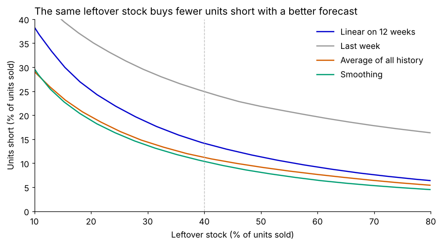](../examples/store-sales.ipynb)

    **[Weekly shop sales: from forecast to stock order](../examples/store-sales.ipynb)**

    *Demand and operations*

    A gift shop restocks 30 products every four weeks, and the usual regression
    loses to a plain average. The scorecard shows why and points to a simpler
    forecaster, which leaves a quarter fewer units out of stock.

    Data: two years of orders from a UK online shop. Runs in about 15 seconds.

-   [](../examples/spare-parts.ipynb)

    **[Spare parts: the best score goes to a forecast of zero](../examples/spare-parts.ipynb)**

    *Demand and operations*

    On car parts that sell a few times a year, the lowest average error belongs
    to a forecast of zero for every part. Scores recorded side by side, one of
    them in the parts counter's own terms, and the scorecard show which
    forecaster keeps parts on the shelf.

    Data: monthly sales of 314 car parts, 1998 to 2002. Runs in about 10 seconds.

-   [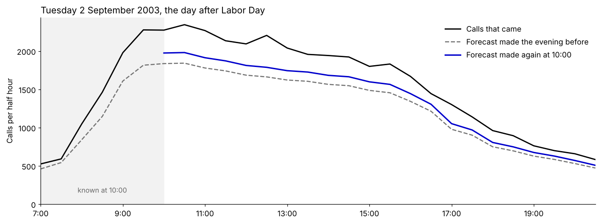](../examples/call-center.ipynb)

    **[Call center staffing: forecast again at ten o'clock](../examples/call-center.ipynb)**

    *Demand and operations*

    A bank's call center plans its agents half hour by half hour. A forecast
    made the evening before is no better than one made two weeks ahead, until
    it looks at how yesterday went. The calls taken by 10:00 improve the rest
    of the day again, if the morning is weighed and not taken at face value.
    And "last week" found by counting rows is 18% worse than by date.

    Data: calls per half hour on 164 working days of 2003. Runs in about 15 seconds.

-   [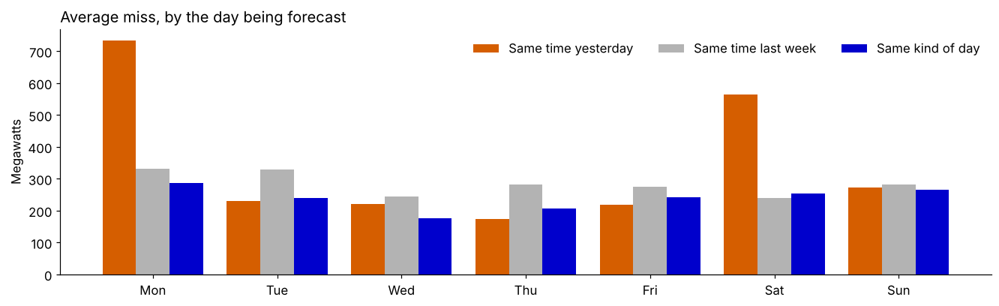](../examples/electricity-demand.ipynb)

    **[Tomorrow's electricity demand: let the worst days say what is missing](../examples/electricity-demand.ipynb)**

    *Energy and environment*

    A day-ahead forecast goes from a 345 to a 223 megawatt miss in three
    rounds, each prompted by asking which days went wrong: first the weekday,
    then public holidays. What is left points at the weather, which the data
    does not contain.

    Data: half-hourly demand in Victoria, Australia, 2014. Runs in about 15 seconds.

-   [](../examples/river-flow.ipynb)

    **[River flow: checking the range, not only the forecast](../examples/river-flow.ipynb)**

    *Energy and environment*

    A 90% range for a river's flow holds 94% of the time, yet it is as wide in
    August as in the spring melt and dips below zero. One argument repairs it
    for ordinary days. On the days the river rises fast, the run shows it
    cannot be trusted.

    Data: daily flow of the Saugeen River, Ontario, 1950 to 1979. Runs in about 50 seconds.

-   [](../examples/rain.ipynb)

    **[Will it rain tomorrow? Score the forecast you already have](../examples/rain.ipynb)**

    *Energy and environment*

    The best of four forecasters of our own beats "it rains one day in three"
    by 11%. The forecast the weather service had already published beats it by
    53%, and still beats ours from five days out. The same run shows why the
    forecaster that is right most often has the worst score.

    Data: daily rain and the official chance of rain in Sydney, 2015 to 2017. Runs in about 10 seconds.

-   [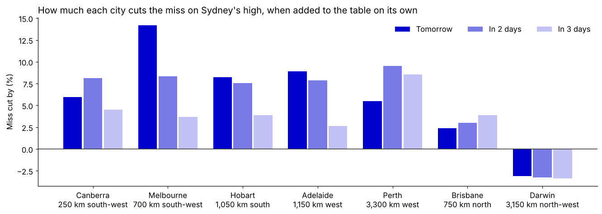](../examples/daily-temperature.ipynb)

    **[Tomorrow's temperature: which city should Sydney watch?](../examples/daily-temperature.ipynb)**

    *Energy and environment*

    Adding Melbourne's temperatures to the table cuts the miss on tomorrow's
    high in Sydney by 14%. Perth helps most two and three days out, and Darwin
    makes the forecast worse. Two cities give what all eight give. Each test
    is one more column, on the same days, with an interval for the gain.

    Data: daily highs in eight Australian cities, 2015 to 2017. Runs in about 25 seconds.

-   [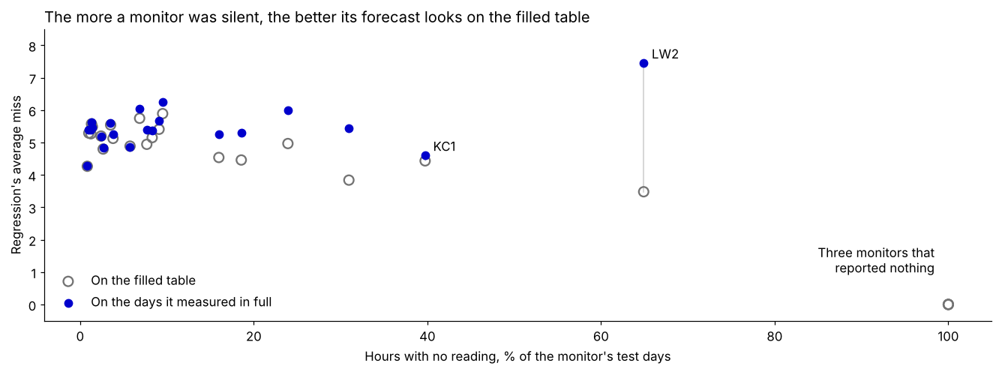](../examples/air-quality.ipynb)

    **[Tomorrow's air in London: the gaps someone filled in for you](../examples/air-quality.ipynb)**

    *Energy and environment*

    On a table with its gaps filled in, every forecast of London's fine
    particles looks about a fifth better than it is, and the three monitors
    that reported nothing all winter come out as the easiest to forecast.
    TimeGym will not cut a case through an empty cell, and the cases it keeps
    show which scores were earned against readings nobody took.

    Data: hourly fine particles at 24 London monitors, winter 2017 to 2018. Runs in about a minute.

-   [](../examples/sunspots.ipynb)

    **[The sunspot cycle: how far ahead is a forecast worth making?](../examples/sunspots.ipynb)**

    *Chaotic but partly predictable*

    Over eleven years ahead, a regression ties with "the same as eleven years
    ago". Split by years ahead, it is almost twice as good for next year and
    adds nothing from the third. The scorecard shows how little room an
    irregular cycle leaves a cleverer model.

    Data: yearly sunspot numbers, 1700 to 1988. Runs in about 15 seconds.

-   [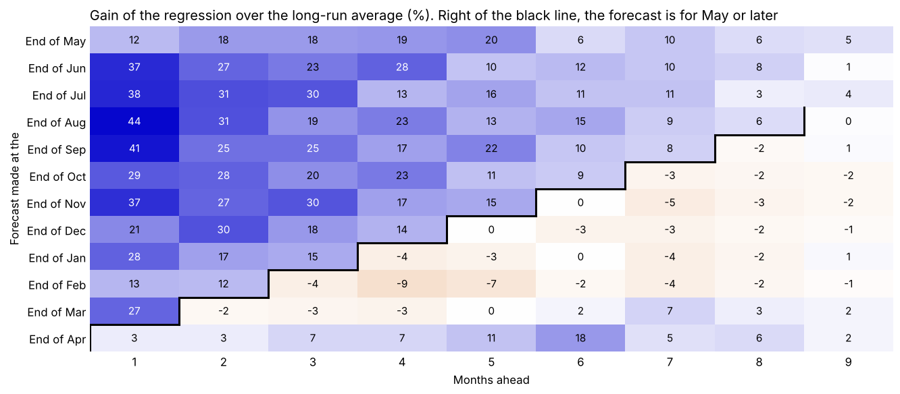](../examples/el-nino.ipynb)

    **[El Niño: how far ahead depends on the month you ask](../examples/el-nino.ipynb)**

    *Chaotic but partly predictable*

    A backtest says a regression on the Southern Oscillation Index is worth
    using for seven months ahead. Sorted by the month each forecast was made
    in, the kept run says something else: nothing gets across April, and a
    forecast that does not have to is still ahead nine months out. Earlier
    years and generated series with no seasons show it is not luck.

    Data: the monthly Southern Oscillation Index, 1900 to 2005. Runs in about 20 seconds.

-   [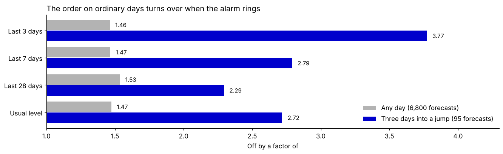](../examples/traffic-jump.ipynb)

    **[A traffic jump: is this the new normal?](../examples/traffic-jump.ipynb)**

    *Web and product*

    On ordinary days, following the last three days is as good as anything
    and a four-week average is the worst. Three days into a jump the order
    turns over, and the usual backtest cannot show it: jumps are 0.2% of its
    days. Most jumps fade, so a forecaster that learns the fade from earlier
    jumps beats all four. Two weeks later the ordinary order is back.

    Data: daily views of 136 Wikipedia pages, 2015 to 2017. Runs in about 35 seconds.

-   [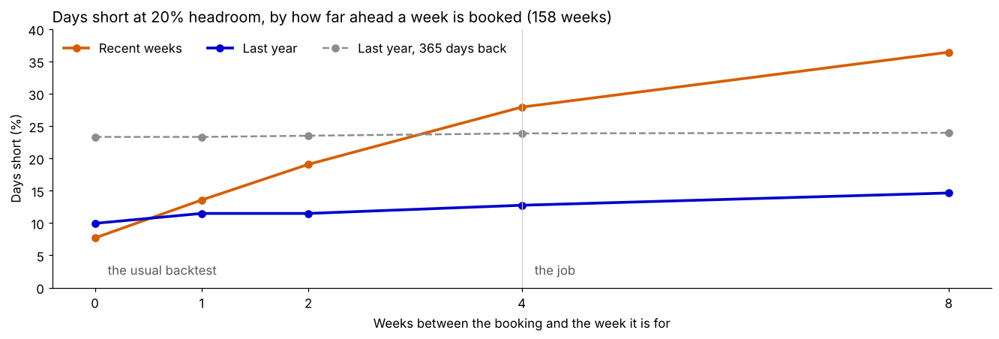](../examples/site-capacity.ipynb)

    **[Site capacity: which forecast still works four weeks ahead?](../examples/site-capacity.ipynb)**

    *Web and product*

    Two forecasters of a site's page views are level when they forecast next
    week. Booked four weeks ahead, which is the job, one leaves the site
    short on 28% of days and the other on 13%, and spare capacity sized on
    next week's forecasts gives 24% of days short where the aim was 5%. A
    generated weekly cycle catches a one-day slip before any of it.

    Data: daily page views of a textbook site, 2018 to 2022. Runs in about 10 seconds.

-   [](../examples/bitcoin.ipynb)

    **[Bitcoin: finding out you have nothing](../examples/bitcoin.ipynb)**

    *Finance*

    A first backtest calls the direction of tomorrow's price right on 79% of
    days. Run through TimeGym, where a model only ever gets the past, it does
    no better than always saying "up".

    Data: daily Bitcoin price, 2014 to 2021. Runs in about 15 seconds.

-   [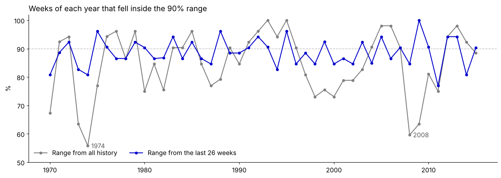](../examples/sp500.ipynb)

    **[The S&P 500 next week: the direction and the size are different questions](../examples/sp500.ipynb)**

    *Finance*

    No forecaster here calls next week's direction better than always saying
    "up". The size of the move can be forecast: a 90% range built from the
    last 26 weeks held in calm years and in crashes, while one built from all
    of history held on 60% of the weeks of 2008. The same weeks in random
    order show the gain comes from the market, not the code.

    Data: the S&P 500 index week by week, 1950 to 2015. Runs in about 85 seconds.

-   [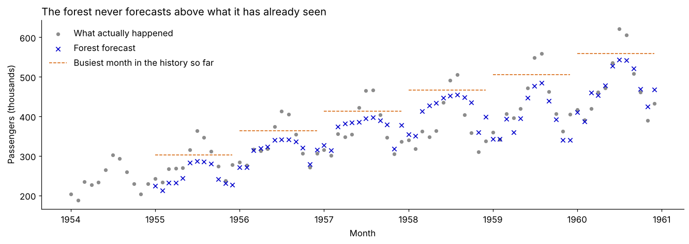](../examples/passenger-growth.ipynb)

    **[The forest that cannot follow growth](../examples/passenger-growth.ipynb)**

    *Lessons that cut across domains*

    A random forest passes its backtest on airline passengers. The scorecard
    shows it cannot forecast a trend, and that the textbook fix makes it worse
    on almost everything else.

    Data: monthly airline passengers, 1949 to 1960. Runs in about 80 seconds.

-   [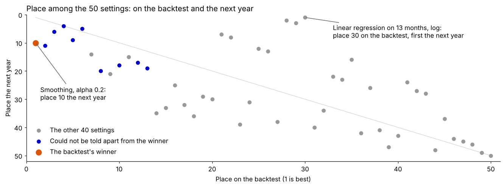](../examples/best-of-fifty.ipynb)

    **[You tried 50 models: is the winner real?](../examples/best-of-fifty.ipynb)**

    *Lessons that cut across domains*

    Fifty settings on one backtest, and a winner ahead by 0.2%. Each case's
    score shows nine others cannot be told apart from it, and that a winning
    score flatters by about 4%. The next year the winner comes tenth. The
    scorecard gives better reasons to choose among the tied.

    Data: monthly patient counts for 114 medical products, 2000 to 2006. Runs in about 40 seconds.

</div>

## Run an example yourself

The notebooks are in the repository's
[`examples/`](../examples/README.md) folder, not in the installed package.
From a clone:

```bash
git clone https://github.com/diogoseca/timegym.git
cd timegym
python -m pip install -e '.[examples]'
python -m jupyterlab examples
```

Every example reads a small sample of its data that is committed in the
repository, so it runs offline. Select the Python kernel of the environment
you installed into, and use **Restart Kernel and Run All Cells**.

## The data

Each dataset is public and comes with a license that allows sharing it with
credit. [Example data](../examples/data/README.md) lists, for each one, the
source, the license, the credit line, what we changed and the checksums.

The committed samples are small: from a few hundred rows to one year of
half-hours, or a few dozen products.
To work with a whole dataset, ask the loader for it. It downloads the source
once, checks it against the recorded checksum and keeps a copy on your
computer:

```python
from example_data import load

sample = load("store-sales")                  # 30 products, committed in the repository
everything = load("store-sales", full=True)   # every product, downloaded on first use
```

## More on the way

These examples are planned. Each one is added once its notebook has run on real
data and we know what the result is.

- **Demand and operations:** bakery demand around holidays, bike-share
  stations, emergency room arrivals.
- **Energy and environment:** solar farm output.
- **Chaotic but partly predictable:** flu season.
- **Lessons that cut across domains:** a ready-made model against your own.
