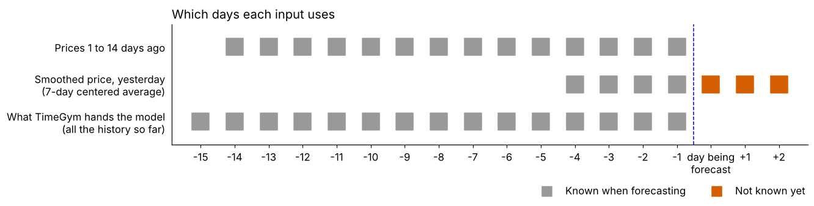

# Examples

Each example is a forecasting job on real public data, from the first model to
a decision, with TimeGym in the loop: what we tried first, what TimeGym showed,
and what we changed. The numbers are what came out when the notebook ran,
including the places where the plan we started with did not hold.

A [tutorial](tutorials.md) explains one tool. An example shows a job done, and
links to the tutorials for the tools it uses.

<div class="grid cards example-gallery" markdown>

-   [](../examples/store-sales.ipynb)

    **[Weekly shop sales: from forecast to stock order](../examples/store-sales.ipynb)**

    *Demand and operations*

    A gift shop restocks 30 products every four weeks, and the usual regression
    loses to a plain average. The scorecard shows why and points to a simpler
    forecaster, which leaves a quarter fewer units out of stock.

    Data: two years of orders from a UK online shop. Runs in about 15 seconds.

-   [](../examples/passenger-growth.ipynb)

    **[The forest that cannot follow growth](../examples/passenger-growth.ipynb)**

    *Lessons that cut across domains*

    A random forest passes its backtest on airline passengers. The scorecard
    shows it cannot forecast a trend, and that the textbook fix makes it worse
    on almost everything else.

    Data: monthly airline passengers, 1949 to 1960. Runs in about 80 seconds.

-   [](../examples/bitcoin.ipynb)

    **[Bitcoin: finding out you have nothing](../examples/bitcoin.ipynb)**

    *Finance*

    A first backtest calls the direction of tomorrow's price right on 79% of
    days. Run through TimeGym, where a model only ever gets the past, it does
    no better than always saying "up".

    Data: daily Bitcoin price, 2014 to 2021. Runs in about 15 seconds.

</div>

## Run an example yourself

The notebooks are in the repository's
[`examples/`](../examples/README.md) folder, not in the installed package.
From a clone:

```bash
git clone https://github.com/diogoseca/timegym.git
cd timegym
python -m pip install -e '.[examples]'
python -m jupyterlab examples
```

Every example reads a small sample of its data that is committed in the
repository, so it runs offline. Select the Python kernel of the environment
you installed into, and use **Restart Kernel and Run All Cells**.

## The data

Each dataset is public and comes with a license that allows sharing it with
credit. [Example data](../examples/data/README.md) lists, for each one, the
source, the license, the credit line, what we changed and the checksums.

The committed samples are small: a few hundred rows, or a few dozen products.
To work with a whole dataset, ask the loader for it. It downloads the source
once, checks it against the recorded checksum and keeps a copy on your
computer:

```python
from example_data import load

sample = load("store-sales")                  # 30 products, committed in the repository
everything = load("store-sales", full=True)   # every product, downloaded on first use
```

## More on the way

These examples are planned. Each one is added once its notebook has run on real
data and we know what the result is.

- **Demand and operations:** spare parts that sell twice a year, bakery demand
  around holidays, call center staffing, bike-share stations, emergency room
  arrivals.
- **Energy and environment:** tomorrow's electricity demand, solar farm output,
  river level before a flood, air quality tomorrow, rain tomorrow, daily
  temperature.
- **Chaotic but partly predictable:** flu season, the sunspot cycle, El Niño.
- **Web and product:** signups after a launch, server load for capacity
  planning.
- **Finance:** an S&P 500 fund, where the direction of a move and its size are
  different questions.
- **Lessons that cut across domains:** picking the best of 50 models, and a
  ready-made model against your own.
