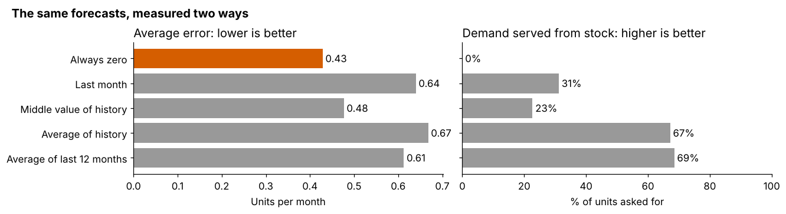
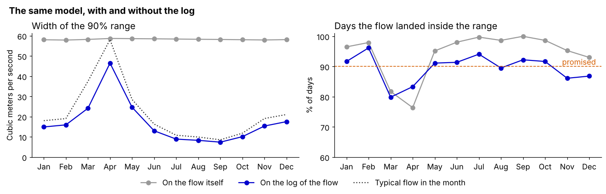
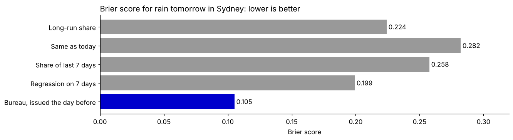
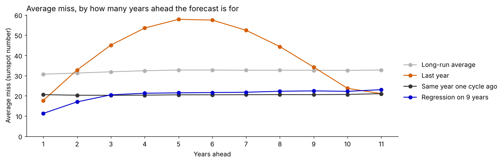

# Examples

Each example is a forecasting job on real public data, from the first model to
a decision, with TimeGym in the loop: what we tried first, what TimeGym showed,
and what we changed. The numbers are what came out when the notebook ran,
including the places where the plan we started with did not hold.

A [tutorial](tutorials.md) explains one tool. An example shows a job done, and
links to the tutorials for the tools it uses.

<div class="grid cards example-gallery" markdown>

-   [](../examples/store-sales.ipynb)

    **[Weekly shop sales: from forecast to stock order](../examples/store-sales.ipynb)**

    *Demand and operations*

    A gift shop restocks 30 products every four weeks, and the usual regression
    loses to a plain average. The scorecard shows why and points to a simpler
    forecaster, which leaves a quarter fewer units out of stock.

    Data: two years of orders from a UK online shop. Runs in about 15 seconds.

-   [](../examples/spare-parts.ipynb)

    **[Spare parts: the best score goes to a forecast of zero](../examples/spare-parts.ipynb)**

    *Demand and operations*

    On car parts that sell a few times a year, the lowest average error belongs
    to a forecast of zero for every part. Scores recorded side by side, one of
    them in the parts counter's own terms, and the scorecard show which
    forecaster keeps parts on the shelf.

    Data: monthly sales of 314 car parts, 1998 to 2002. Runs in about 10 seconds.

-   [](../examples/electricity-demand.ipynb)

    **[Tomorrow's electricity demand: let the worst days say what is missing](../examples/electricity-demand.ipynb)**

    *Energy and environment*

    A day-ahead forecast goes from a 345 to a 223 megawatt miss in three
    rounds, each prompted by asking which days went wrong: first the weekday,
    then public holidays. What is left points at the weather, which the data
    does not contain.

    Data: half-hourly demand in Victoria, Australia, 2014. Runs in about 15 seconds.

-   [](../examples/river-flow.ipynb)

    **[River flow: checking the range, not only the forecast](../examples/river-flow.ipynb)**

    *Energy and environment*

    A 90% range for a river's flow holds 94% of the time, yet it is as wide in
    August as in the spring melt and dips below zero. One argument repairs it
    for ordinary days. On the days the river rises fast, the run shows it
    cannot be trusted.

    Data: daily flow of the Saugeen River, Ontario, 1950 to 1979. Runs in about 50 seconds.

-   [](../examples/rain.ipynb)

    **[Will it rain tomorrow? Score the forecast you already have](../examples/rain.ipynb)**

    *Energy and environment*

    The best of four forecasters of our own beats "it rains one day in three"
    by 11%. The forecast the weather service had already published beats it by
    53%, and still beats ours from five days out. The same run shows why the
    forecaster that is right most often has the worst score.

    Data: daily rain and the official chance of rain in Sydney, 2015 to 2017. Runs in about 10 seconds.

-   [](../examples/sunspots.ipynb)

    **[The sunspot cycle: how far ahead is a forecast worth making?](../examples/sunspots.ipynb)**

    *Chaotic but partly predictable*

    Over eleven years ahead, a regression ties with "the same as eleven years
    ago". Split by years ahead, it is almost twice as good for next year and
    adds nothing from the third. The scorecard shows how little room an
    irregular cycle leaves a cleverer model.

    Data: yearly sunspot numbers, 1700 to 1988. Runs in about 15 seconds.

-   [](../examples/bitcoin.ipynb)

    **[Bitcoin: finding out you have nothing](../examples/bitcoin.ipynb)**

    *Finance*

    A first backtest calls the direction of tomorrow's price right on 79% of
    days. Run through TimeGym, where a model only ever gets the past, it does
    no better than always saying "up".

    Data: daily Bitcoin price, 2014 to 2021. Runs in about 15 seconds.

-   [](../examples/passenger-growth.ipynb)

    **[The forest that cannot follow growth](../examples/passenger-growth.ipynb)**

    *Lessons that cut across domains*

    A random forest passes its backtest on airline passengers. The scorecard
    shows it cannot forecast a trend, and that the textbook fix makes it worse
    on almost everything else.

    Data: monthly airline passengers, 1949 to 1960. Runs in about 80 seconds.

</div>

## Run an example yourself

The notebooks are in the repository's
[`examples/`](../examples/README.md) folder, not in the installed package.
From a clone:

```bash
git clone https://github.com/diogoseca/timegym.git
cd timegym
python -m pip install -e '.[examples]'
python -m jupyterlab examples
```

Every example reads a small sample of its data that is committed in the
repository, so it runs offline. Select the Python kernel of the environment
you installed into, and use **Restart Kernel and Run All Cells**.

## The data

Each dataset is public and comes with a license that allows sharing it with
credit. [Example data](../examples/data/README.md) lists, for each one, the
source, the license, the credit line, what we changed and the checksums.

The committed samples are small: from a few hundred rows to one year of
half-hours, or a few dozen products.
To work with a whole dataset, ask the loader for it. It downloads the source
once, checks it against the recorded checksum and keeps a copy on your
computer:

```python
from example_data import load

sample = load("store-sales")                  # 30 products, committed in the repository
everything = load("store-sales", full=True)   # every product, downloaded on first use
```

## More on the way

These examples are planned. Each one is added once its notebook has run on real
data and we know what the result is.

- **Demand and operations:** bakery demand around holidays, call center
  staffing, bike-share stations, emergency room arrivals.
- **Energy and environment:** solar farm output, air quality tomorrow, daily
  temperature.
- **Chaotic but partly predictable:** flu season, El Niño.
- **Web and product:** signups after a launch, server load for capacity
  planning.
- **Finance:** an S&P 500 fund, where the direction of a move and its size are
  different questions.
- **Lessons that cut across domains:** picking the best of 50 models, and a
  ready-made model against your own.
