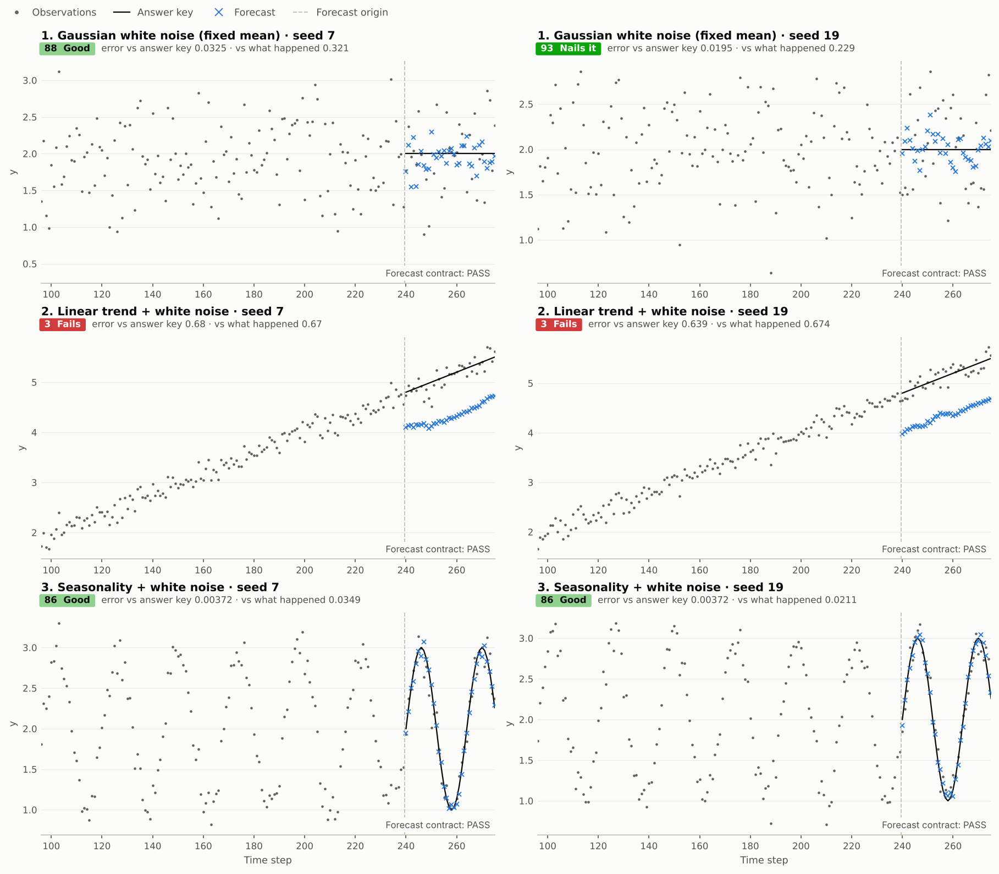

# Working with notebooks

All notebooks live under [`notebooks/`](../notebooks/README.md). The collection
has **15 source notebooks**, which generate the package, and **10 application
notebooks**, which use it. The original 11 notebooks remain in
[`notebooks/archive/`](../notebooks/archive/README.md) in Git, outside the source
distribution.

From a clone or extracted source distribution:

```bash
python -m pip install -e '.[notebooks]'
python -m jupyterlab notebooks
```

Select the Python kernel belonging to that environment. Start with
[00 · Quick start](../notebooks/00_quick_start.ipynb), then choose an application
from the [notebook guide](../notebooks/README.md). The examples use CPU and local
data; the real-data notebook reads the included AirPassengers CSV.
`timegym.data.real.get_stock` is a separate opt-in network helper for Yahoo
Finance, requiring `timegym[market-data]` for a fetch. It is not called by the
notebooks. Its local snapshot cache supports offline reuse; see the
[market-data contract](reference.md#optional-market-data).

## Read, experiment, and build

Source notebooks 01–15 pair explanations and examples with editable
implementation cells. Expand those cells to change the library. Application
notebooks 00 and 20–28 import the library and focus on forecasting problems.
Each notebook runs in its own kernel without variables from another notebook.

The original `%%runwrite` workflow made notebooks a place to develop both the
code and its explanation. The current workflow retains that relationship with
nbdev 3.3.26's modular exporter. Save a source notebook, then explicitly build:

```bash
python tools/export_notebooks.py
python tools/export_notebooks.py --check
```

Export reads marked source cells without executing them or reading their outputs.
Normal **Run All** does not write package files. After changing an implementation
cell, restart and Run All to refresh its development bindings and experiment. Changes used by
other chapters require saving, exporting, and restarting their kernels so imports
load the updated modules. The [source map](../notebooks/source-map.json) declares
module ownership; check mode detects differences between saved notebooks and
generated modules. See the [build guide](../tools/README.md) for details.

## Execute and inspect

```bash
# Check every active notebook in an independent fresh kernel.
python notebooks/check_notebooks.py

# Work on one group, or save outputs and rendered HTML for review.
python notebooks/check_notebooks.py --group source
python notebooks/check_notebooks.py --group demo
python notebooks/check_notebooks.py --write --html-dir /tmp/timegym-notebooks
```

The checker uses the invoking Python interpreter, clears stale outputs before
execution, and rejects uncaught errors or skipped code. It excludes the archive.
Inspect plots as well as execution results; successful execution does not prove
that labels, scales, or explanations are useful. Seeded results are reproducible
within an environment, while numerical and rendering versions can affect output.

The plots distinguish point means at discrete horizons from uncertainty bands
and joint sample paths. Marginal intervals are not simultaneous prediction
regions. Independent synthetic cases supply replications; horizons and targets
within a forecast do not become additional independent cases.

The [joint financial uncertainty tutorial](../notebooks/27_joint_financial_uncertainty.ipynb) extends the financial examples to dependent targets and controlled cross-series pairing faults. [Source notebook 15](../notebooks/15_joint_processes.ipynb) explains and builds the joint generators.

## Write and test a custom model

[28 · Write and test a custom model](../notebooks/28_custom_model.ipynb) builds a
k-nearest-analogues forecaster in three steps: write `fit(context)` and
`predict(future_index)`, test it on known scenarios with `Pipeline.test`, then
forecast real observations and a semi-synthetic series with supplied truth.
Whole historical continuations supply empirical joint paths; their average
supplies point predictions. An injected missing-row fault demonstrates a
contract `FAIL`, while valid but inaccurate forecasts retain descriptive scores.



This revives the 2021 KNN figure's visual comparison using the v2 plotting
helpers. It does not reproduce the original recursive implementation. Contract
success does not establish accuracy: raw historical continuations cannot
extrapolate a rising level beyond their observed range.

For raw real data, use `Case(reference=None, ...)`; unavailable reference checks
remain `UNSUPPORTED`. For a declared Gaussian semi-synthetic process,
`Reference.from_function(truth, index, covariance=..., target_names=...)`
evaluates a known mean function once and validates its explicit covariance.
The function returns `(horizon, targets)` values or an exactly aligned
DataFrame. The tutorial's fixed curve comes from AirPassengers and is truth
only for the constructed process, not an estimate promoted to the true law
of the historical data. Custom models and truth functions require the notebook
code for reproduction; automatic report replay does not reconstruct them.
