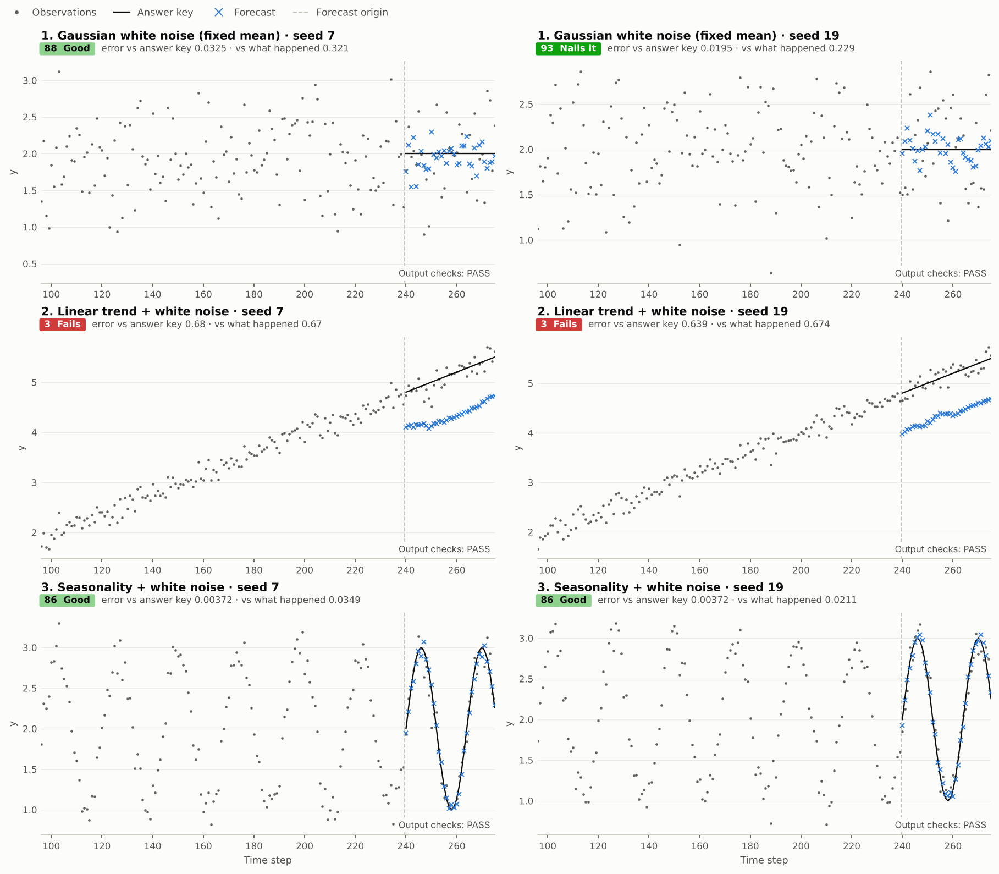

# Tutorials

TimeGym is for testing a forecasting pipeline before deployment and for
reproducing a failure after one. The twelve tutorials are notebooks that run on
CPU with local data and explicit seeds. Start with the quick start, then write
and test your own model, then pick by what you want to check.

## What do you want to check?

| I want to | Start with | Then look up |
| --- | --- | --- |
| See what my forecaster gets right and wrong | [01 · Quick start](../tutorials/01_quick_start.ipynb) | [Scorecards and the scenario grid](api/scorecard.md), [Pipeline and reports](api/pipeline.md) |
| Plug in my own model and check its outputs | [02 · Write and test a custom model](../tutorials/02_custom_model.ipynb) | [Tasks and forecasts](api/tasks-and-forecasts.md) |
| Tell a broken output from a weak model, and replay a failure | [03 · Faults, repairs and replay](../tutorials/03_faults_repairs_and_replay.ipynb) | [Scores and diagnostics](api/diagnostics.md), [Fault fixtures](api/fault-fixtures.md) |
| Choose a target transform or a reduction | [04 · Target transforms](../tutorials/04_target_transforms.ipynb), [05 · Reductions](../tutorials/05_reductions.ipynb) | [Data preparation](api/data-preparation.md), [Models and reductions](api/models.md) |
| Forecast several targets, or real data at several origins | [06 · Multivariate forecasting](../tutorials/06_multivariate_forecasting.ipynb), [07 · Real-data forecasts](../tutorials/07_real_data_forecasts.ipynb) | [Tasks and forecasts](api/tasks-and-forecasts.md) |
| Check intervals, quantiles or sample paths | [08 · Univariate uncertainty](../tutorials/08_univariate_uncertainty.ipynb), [09 · Multivariate uncertainty](../tutorials/09_multivariate_uncertainty.ipynb) | [Scores and diagnostics](api/diagnostics.md) |
| Stress a model with jumps, volatility or regime changes | [10 · Capability sweeps](../tutorials/10_capability_sweeps.ipynb), [11 · Composed and financial stresses](../tutorials/11_composed_and_financial_stresses.ipynb), [12 · Joint financial uncertainty](../tutorials/12_joint_financial_uncertainty.ipynb) | [Composed and joint processes](api/processes.md), [Synthetic scenarios](stress-cases.md) |

## What a clean report covers

A report with no `FAIL` and no `ERROR` does not say the forecasts are accurate;
[How TimeGym decides](concepts/how-timegym-decides.md) lists what it does
establish.

## The tutorials in order

The groups follow a path: a first run and your own model, then the failures
TimeGym exists to catch, then modeling choices, uncertainty and stress tests.
The numbers follow this order.

| Group | Tutorial | Question it answers |
| --- | --- | --- |
| Start | [01 · Quick start](../tutorials/01_quick_start.ipynb) | Which kinds of series does my forecaster get right, and which does it get wrong? |
| | [02 · Write and test a custom model](../tutorials/02_custom_model.ipynb) | How do I test a model I wrote myself? |
| Find what breaks | [03 · Faults, repairs and replay](../tutorials/03_faults_repairs_and_replay.ipynb) | What does a broken output look like, and how do I replay it? |
| Shape the forecast | [04 · Target transforms](../tutorials/04_target_transforms.ipynb) | Which transform of the target, and what does inverting it do? |
| | [05 · Reductions](../tutorials/05_reductions.ipynb) | Recursive, direct or multioutput: where do their errors differ? |
| | [06 · Multivariate forecasting](../tutorials/06_multivariate_forecasting.ipynb) | How do I forecast and score several targets? |
| | [07 · Real-data forecasts](../tutorials/07_real_data_forecasts.ipynb) | How do I evaluate on real data at ordered origins? |
| Measure uncertainty | [08 · Univariate uncertainty](../tutorials/08_univariate_uncertainty.ipynb) | Are my intervals and quantiles calibrated? |
| | [09 · Multivariate uncertainty](../tutorials/09_multivariate_uncertainty.ipynb) | Do my joint paths keep the dependence between targets? |
| Stress-test | [10 · Capability sweeps](../tutorials/10_capability_sweeps.ipynb) | Where does each model stop coping as the history shortens or the noise grows? |
| | [11 · Composed and financial stresses](../tutorials/11_composed_and_financial_stresses.ipynb) | How does it handle jumps, GARCH and hidden regimes? |
| | [12 · Joint financial uncertainty](../tutorials/12_joint_financial_uncertainty.ipynb) | Does joint uncertainty survive shared shocks and broken dependence? |

## Run the notebooks

From a clone or extracted source distribution:

```bash
python -m pip install -e '.[notebooks]'
python -m jupyterlab tutorials
```

Select the Python kernel belonging to that environment and use **Restart Kernel
and Run All Cells**. Each notebook runs in its own kernel. The real-data
notebook reads the included AirPassengers CSV; no notebook uses the network
([Market data](api/market-data.md) covers the optional fetch helper).

The tutorials live in `tutorials/` ([tutorials guide](../tutorials/README.md)).
The 15 source notebooks in `source/` are the package's code, not tutorials: they
and the checks that execute every notebook are described in
[Contributing](contributing.md) and the [source guide](../source/README.md).

## Bring your own model

[02 · Write and test a custom model](../tutorials/02_custom_model.ipynb) builds a
k-nearest-analogues forecaster in three steps: write `fit(context)` and
`predict(future_index)`, test it on known scenarios with `Pipeline.test`, then
forecast real observations and a semi-synthetic series with supplied truth.
Whole historical continuations supply empirical joint paths; their average
supplies point predictions. An injected missing-row fault demonstrates a
contract `FAIL`, while valid but inaccurate forecasts retain descriptive scores.



This revives the 2021 KNN figure's visual comparison using the plotting
helpers. It does not reproduce the original recursive implementation. Contract
success does not establish accuracy: raw historical continuations cannot
extrapolate a rising level beyond their observed range.

For raw real data, use `Case(reference=None, ...)`; unavailable reference checks
remain `UNSUPPORTED`. For a declared Gaussian semi-synthetic process,
`Reference.from_function(truth, index, covariance=..., target_names=...)`
evaluates a known mean function once and validates its explicit covariance.
The function returns `(horizon, targets)` values or an exactly aligned
DataFrame. The tutorial's fixed curve comes from AirPassengers and is truth
only for the constructed process, not an estimate promoted to the true law
of the historical data. Custom models and truth functions require the notebook
code for reproduction; automatic report replay does not reconstruct them.
